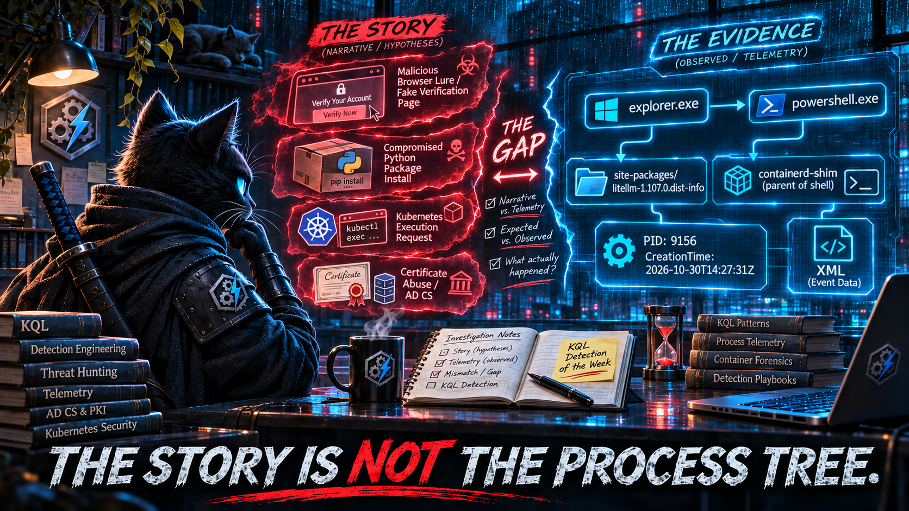

Short version of the last fortnight: one server, one Raspberry Pi, and one laptop all died in the same week 💀. Mercury is apparently in retrograde about 90% of the time now. Everything's rebuilt, the [DevSecOpsDadAttack Detection Engineering pipeline](https://devsecopsdadattack.com/detectionengineering/) is back on its feet, and it handed me twenty-six detections across seven days: six for the LiteLLM supply-chain compromise, four for AD CS ESC1/ESC8 abuse, three for the Node.js Brotli CVE, three for a malicious Claude Code-branded Cursor extension, two each for BeyondTrust, PHP, and Kubernetes isolation bypass, and one each for OpenCTI, ClickFix, NetamLoader, and Metasploit.

Read them back to back and one shape keeps showing up. **Eleven of the twenty-six detections boil down to "process A launched process B."** PHP-FPM spawns a shell. Node spawns a shell. kubelet spawns a shell. A browser spawns PowerShell. An IDE spawns ssh. A loader spawns a child that loads a DLL. Parent-child lineage is one of the best detection primitives Defender gives you, so this isn't a complaint about the primitive. The problem is how the pipeline got from the threat report to the parent.

A threat report is a story. *The user visited a malicious page and ran a command. The developer installed the compromised version. The attacker exec'd into the cluster through kubelet.* Those are sentences with subjects, verbs, and causes. The pipeline translated the cause in each sentence into a parent in a process tree. The process tree isn't a record of causes, though. It's a record of which process called `CreateProcess` or `execve`, and that is very often not the thing the story was about.

**The story says the browser. The tree says explorer.exe.**

Act I is ClickFix: a technique whose whole design goal is to keep the browser out of the process tree, detected by looking for the browser in the process tree. Act II is LiteLLM: six detections built around the version string the victim typed, for an attack where the victim never types the version. The honorable mention is Kubernetes, where kubelet is the story and `containerd-shim` is the parent. The bonus round is NetamLoader, which joins a child process to its image loads by *filename*. That's a join on a rumor about a process, not on the process. A lightning round on `SecurityEvent.EventData` closes it out, where the rendered message is the story and the XML is the record.

Same note as always: every replacement in this edition has been checked structurally against the documented schemas of the tables it uses, not run against live tenant data. Telemetry population varies by workspace, connector, sensor version, and OS. Treat each one as a hunting query until it passes the validation checks in your own environment.

<br/>

### The Week at a Glance

| Day | Detections | Built on parent→child lineage | Clusters |
|---|---|---|---|
| [Mon 26 Oct](https://devsecopsdadattack.com/2026-10-26-detection-engineering-brief-monday-october-26-2026/) | 5 | 2 | LiteLLM ×3, OpenCTI, PHP |
| [Tue 27 Oct](https://devsecopsdadattack.com/2026-10-27-detection-engineering-brief-tuesday-october-27-2026/) | 5 | 0 | LiteLLM ×3, Node.js inventory, Metasploit |
| [Wed 28 Oct](https://devsecopsdadattack.com/2026-10-28-detection-engineering-brief-wednesday-october-28-2026/) | 4 | 2 | Node.js ×2, Kubernetes ×2 |
| [Thu 29 Oct](https://devsecopsdadattack.com/2026-10-29-detection-engineering-brief-thursday-october-29-2026/) | 1 | 1 | NetamLoader |
| [Fri 30 Oct](https://devsecopsdadattack.com/2026-10-30-detection-engineering-brief-friday-october-30-2026/) | 1 | 1 | ClickFix |
| [Sat 31 Oct](https://devsecopsdadattack.com/2026-10-31-detection-engineering-brief-saturday-october-31-2026/) | 5 | 3 | AD CS ×2, BeyondTrust, IDE extension, PHP |
| [Sun 1 Nov](https://devsecopsdadattack.com/2026-11-01-detection-engineering-brief-sunday-november-1-2026/) | 5 | 2 | IDE extension ×2, AD CS ×2, BeyondTrust |
| **Total** | **26** | **11** | |

<br/>

---

<br/>

## 🥇 Act I: ClickFix Never Has a Browser Parent

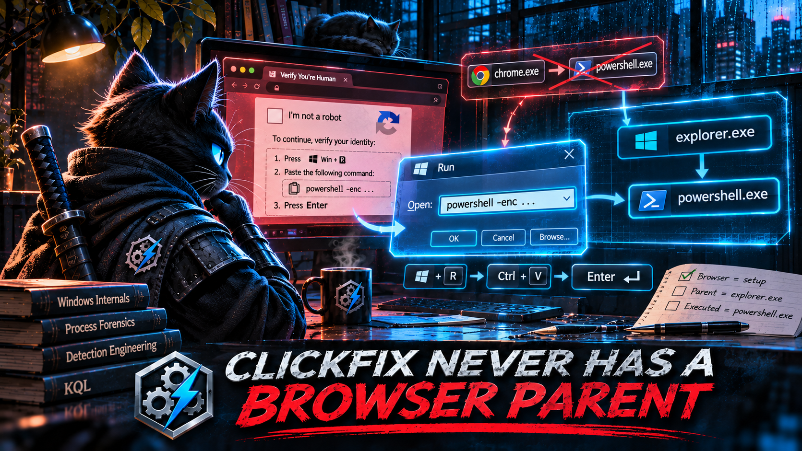

[Friday's only detection](https://devsecopsdadattack.com/2026-10-30-detection-engineering-brief-friday-october-30-2026/), drawn from [SANS ISC's latest ClickFix diary](https://isc.sans.edu/diary/rss/33466), is *ClickFix – Browser-Spawned Script Interpreter Execution*. The brief's intelligence context describes "the established ClickFix pattern" as a browser process spawning `cmd.exe`, `powershell.exe`, `mshta.exe`, or `wscript.exe`. The query does exactly that:

```kql
let BrowserProcesses = dynamic(["chrome.exe", "msedge.exe", "firefox.exe", "iexplore.exe", "brave.exe", "opera.exe"]);
let ScriptInterpreters = dynamic(["cmd.exe", "powershell.exe", "mshta.exe", "wscript.exe", "cscript.exe"]);
...
| where InitiatingProcessFileName has_any (BrowserProcesses)
| where FileName has_any (ScriptInterpreters)
```

Here is what a ClickFix lure actually asks the victim to do. A fake CAPTCHA or fake error page puts a command on the clipboard with JavaScript, then tells the user to press **Win+R**, then **Ctrl+V**, then **Enter**. MITRE's own description of [T1204.004, Malicious Copy and Paste](https://attack.mitre.org/techniques/T1204/004/), gives the reason: tricking a user into running the command themselves helps the attacker get around email filtering, browser sandboxing, and other controls aimed at downloaded files.

Getting around the browser sandbox is the whole design goal. The browser's only job in a ClickFix attack is writing to the clipboard. The Run dialog belongs to `explorer.exe`, so `explorer.exe` launches the pasted command. The newer "FileFix" variant swaps the Run dialog for the File Explorer address bar. That's still `explorer.exe`. The variant that tells the user to press **Win+X** and open Terminal runs the pasted command *inside* an interactive PowerShell whose ancestors are `WindowsTerminal.exe` and `explorer.exe`. In none of these copy-paste variants, which are the mechanism that defines ClickFix, does the browser call `CreateProcess`. The story says the user was "in the browser" when it happened, and the process tree has no record of that.

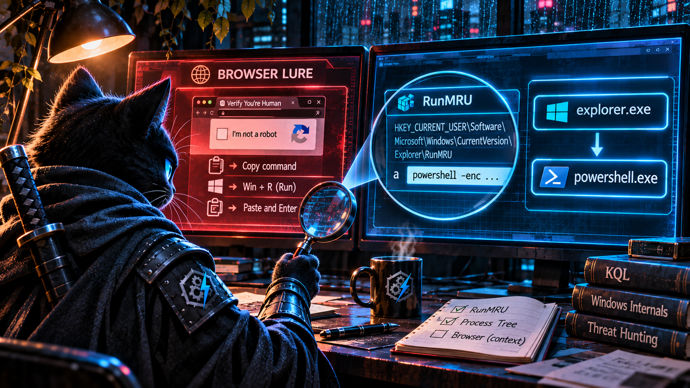

So the detection is aimed at the one parent the technique was built to avoid. When it does fire, it fires on the cases ClickFix *isn't*: drive-by exploits that break out of the renderer, browser-launched protocol handlers, and enterprise portals that launch scripts (the brief's own false-positive list). And it has a second, quieter problem in the network correlation:

```kql
SuspiciousChildProcs
| join kind=leftouter (
    NetworkFollowOn
) on DeviceId
| where isempty(NetworkTime) or (NetworkTime >= ProcessTime and NetworkTime <= ProcessTime + NetworkCorrelationWindow)
```

That's the left-outer-then-filter pattern from [The Stage Is Not the Chain](https://devsecopsdadattack.com/2026-09-14-KQL-Detection-of-the-Week-The-Stage-Is-Not-The-Chain/). If the device has *any* `cmd.exe` or `powershell.exe` network event in the seven-day lookback, the outer join produces matched rows, `NetworkTime` is never empty, and every one of those rows that falls outside the five-minute window gets filtered. The suspicious process row disappears completely instead of being reported without network enrichment. On a typical Windows fleet, where PowerShell talks to the network all day, that removes most of the results. The join is also keyed on `DeviceId` alone, so any interpreter on the device, for any user, counts as "follow-on" activity for any other interpreter.

<br/>

### Find the surface, not the source

If the browser isn't in the tree, what is? The user typed (pasted) something into an `explorer.exe` input surface, and Windows records it. The Run dialog keeps a most-recently-used list at `HKCU\Software\Microsoft\Windows\CurrentVersion\Explorer\RunMRU`, and the Explorer address bar keeps one at `...\Explorer\TypedPaths`. `explorer.exe` writes to both. The browser writes to neither. On a default Windows configuration, every Run-dialog variant of ClickFix leaves an entry there, because that's how the Run dialog works, and the lure doesn't get to choose. Two conditions apply, and the validation checks below test both: MRU history can be turned off by policy, and your sensor has to actually report the write.

Then correlate: within seconds of the registry write, did `explorer.exe` launch a process matching what was typed?

### The KQL

```kql
let lookback     = 1d;
let launchWindow = 15s;
// Tools a pasted one-liner needs in order to do anything.
// These are requirements of the payload, not names the lure
// gets to choose.
let PayloadTools = dynamic([
    "powershell", "pwsh", "mshta", "cmd", "wscript", "cscript",
    "rundll32", "regsvr32", "msiexec", "curl", "bitsadmin",
    "certutil", "conhost", "forfiles", "finger", "wmic"
]);
// ============================================================
// STAGE 1: WHAT WAS TYPED, OR PASTED, INTO AN EXPLORER
// INPUT SURFACE.
//
//   RunMRU     = the Win+R Run dialog
//   TypedPaths = the File Explorer address bar ("FileFix")
//
// explorer.exe writes these values in the user's hive when
// something is run from them. The browser never touches them.
// ============================================================
let TypedCommands =
    DeviceRegistryEvents
    | where Timestamp >= ago(lookback)
    | where ActionType == "RegistryValueSet"
    | where RegistryKey endswith @"\Explorer\RunMRU"
         or RegistryKey endswith @"\Explorer\TypedPaths"
    | where RegistryValueName != "MRUList"
    | extend Surface = iff(RegistryKey endswith @"\RunMRU",
                           "RunDialog", "ExplorerAddressBar")
    // RunMRU entries carry a trailing "\1". Strip it.
    | extend Typed      = trim_end(@"\\1", RegistryValueData)
    | extend TypedLower = tolower(Typed)
    // ── What makes a typed command look pasted ──
    | extend HasTool     = TypedLower has_any (PayloadTools)
    | extend HasRemote   = TypedLower contains "http://"
                        or TypedLower contains "https://"
    | extend HasEncoding = TypedLower matches regex
          @"(-e(nc(odedcommand)?)?\s|frombase64|\biex\b|invoke-expression|downloadstring|\birm\b|\biwr\b)"
    // Lures pad the command with a "# I am not a robot..." comment
    // so the visible tail of the Run box looks harmless.
    | extend HasDecoy    = Typed contains "#"
    // Hand-typed Run commands are rarely 80+ characters.
    | extend IsLong      = strlen(Typed) >= 80
    | extend PasteScore  = toint(HasRemote) + toint(HasEncoding)
                         + toint(HasDecoy)  + toint(IsLong)
    | where HasTool and PasteScore >= 1
    // The first token is what explorer.exe will launch:
    // "powershell", "mshta", "conhost", or a full path to one.
    | extend FirstToken = tolower(extract(
          @"^\s*""?(?:[^\s""]*[\\/])?([^\\/\s"".]+)", 1, Typed))
    | project RegTime = Timestamp, DeviceId, DeviceName,
              RegistryKey, RegistryValueName, Surface, Typed,
              FirstToken, HasRemote, HasEncoding, HasDecoy, IsLong,
              PasteScore, Writer = InitiatingProcessFileName;
// ============================================================
// STAGE 2: WHAT EXPLORER LAUNCHED.
// ============================================================
let ExplorerLaunches =
    DeviceProcessEvents
    | where Timestamp >= ago(lookback)
    | where InitiatingProcessFileName =~ "explorer.exe"
    | extend ChildStem = tolower(extract(@"^([^.]+)", 1, FileName))
    | project LaunchTime = Timestamp, DeviceId, ChildStem,
              ChildName = FileName, ChildCommandLine = ProcessCommandLine,
              ChildProcessId = ProcessId,
              ChildCreationTime = ProcessCreationTime,
              ChildSHA256 = SHA256, AccountName;
// ============================================================
// CORRELATE → CONSTRAIN → COLLAPSE, in its own CTE, so a
// launch outside the window can't null out the typed command.
// ============================================================
let CorrelatedLaunch =
    TypedCommands
    | project DeviceId, RegTime, RegistryKey, RegistryValueName, FirstToken
    | join kind=inner ExplorerLaunches
        on DeviceId, $left.FirstToken == $right.ChildStem
    | where LaunchTime between ((RegTime - launchWindow) .. (RegTime + launchWindow))
    | summarize arg_min(abs(datetime_diff('millisecond', LaunchTime, RegTime)), *)
        by DeviceId, RegTime, RegistryKey, RegistryValueName
    | project DeviceId, RegTime, RegistryKey, RegistryValueName,
              LaunchTime, ChildName, ChildCommandLine, ChildProcessId,
              ChildCreationTime, ChildSHA256, AccountName;
// ============================================================
// THE VERDICT.
// A suspicious entry with no observed launch is still reported:
// the registry value was written whether or not a process
// event arrived. Whether it was pasted is an inference.
// ============================================================
TypedCommands
| join kind=leftouter CorrelatedLaunch
    on DeviceId, RegTime, RegistryKey, RegistryValueName
| extend Launched = isnotempty(ChildName)
| extend Verdict = case(
      Launched and HasRemote,  "PasteLikeDownloadCradleLaunched",
      Launched,                "PasteLikeCommandLaunched",
                               "PasteLikeCommandLaunchNotObserved")
| project
    RegTime, Verdict, PasteScore, Surface, DeviceName, AccountName,
    Typed, HasRemote, HasEncoding, HasDecoy, IsLong,
    LaunchTime, ChildName, ChildCommandLine, ChildProcessId,
    ChildCreationTime, ChildSHA256, Writer
| order by PasteScore desc, RegTime desc
```

<br/>

### The lines that do the work

The anchor is the registry write. `RunMRU` and `TypedPaths` sit exactly where ClickFix converts from social engineering into execution: the moment the victim's paste becomes a command. The pipeline's version anchored on the lure (the browser). This one anchors on the launch (the explorer surface), which, for the Run-dialog and address-bar variants, is a step the attacker can't move somewhere else without changing technique.

The scoring answers "did a human type this?" with properties of the pasted string, not its contents. Length, a decoy comment, a URL, an encoded or `iex`-style cradle. Those are the shape of a payload built to be pasted. The tool list is there because the command has to invoke *something*, but it only gates in combination with at least one paste indicator. A user typing `cmd` or `powershell` into Win+R scores zero and never appears.

`FirstToken == ChildStem` ties the typed string to the process `explorer.exe` launched. Yes, that's a name comparison, in an edition whose bonus round is about name joins. The difference is scope. A name match on one device, under one parent, inside a fifteen-second window around the registry write is a correlation. A name match across seven days of a fleet is a coincidence (see the bonus round).

The leftouter at the end is the fix for Friday's join. The launch correlation is built and collapsed on its own, then attached to the typed command. A typed command with no launch shows up as `PasteLikeCommandLaunchNotObserved` instead of disappearing.

<br/>

### No registry telemetry? Use the right parent anyway

Registry coverage varies, so here's the fallback. It's the pipeline's query with the parent corrected:

```kql
DeviceProcessEvents
| where Timestamp >= ago(1d)
| where InitiatingProcessFileName =~ "explorer.exe"
| where FileName in~ ("powershell.exe", "pwsh.exe", "mshta.exe", "cmd.exe",
                      "wscript.exe", "cscript.exe", "rundll32.exe",
                      "msiexec.exe", "curl.exe", "conhost.exe")
| where ProcessCommandLine matches regex
    @"(?i)(https?://|frombase64|\biex\b|invoke-expression|downloadstring|\birm\b|\biwr\b|-e(nc(odedcommand)?)?\s)"
| project Timestamp, DeviceName, AccountName, FileName, ProcessCommandLine,
          ProcessId, ProcessCreationTime, SHA256
| order by Timestamp desc
```

When a user starts PowerShell by hand, it doesn't arrive with a download cradle already on its command line. Explorer launching an interpreter that does is the ClickFix shape with or without the registry evidence.

<br/>

### Validate before you deploy

```kql
// 1. Where do download-cradle interpreters ACTUALLY come from
//    in your fleet? This is the brief's own filter with the
//    parent constraint removed.
DeviceProcessEvents
| where Timestamp >= ago(30d)
| where FileName in~ ("cmd.exe", "powershell.exe", "mshta.exe", "wscript.exe", "cscript.exe")
| where ProcessCommandLine has_any ("-enc", "-EncodedCommand", "FromBase64", "IEX",
                                    "Invoke-Expression", "DownloadString", "DownloadFile")
| summarize Events = count(), Devices = dcount(DeviceId) by InitiatingProcessFileName
| order by Events desc
```

```kql
// 2. Does your sensor surface RunMRU writes at all?
DeviceRegistryEvents
| where Timestamp >= ago(7d)
| where RegistryKey endswith @"\Explorer\RunMRU"
| summarize Events = count(), Devices = dcount(DeviceId), Writers = make_set(InitiatingProcessFileName, 5)
```

Check one is the argument of this act, run against your own data. If browsers appear at all, look closely, because that's a different technique. If `explorer.exe` is near the top, that's where ClickFix has been living the whole time. Check two tells you whether the main query can see anything. If it returns zero, run the fallback.

<br/>

### Keeping it honest

- **The Win+X Terminal variant evades both queries.** When the paste lands in an already-open interactive PowerShell, there's no Run-dialog entry and no new process for the pasted command itself. You see its *effects* (child processes, network connections from `powershell.exe`) and, if you collect it, script-block logging (Event 4104). Detecting that variant is a PowerShell-content problem, not a lineage problem.
- **`HasDecoy` is a cheap signal, not a strong one.** Admins put `#` in commands too. That's why it only adds a point to `PasteScore` and never qualifies a row on its own.
- **`TypedPaths` is noisier than `RunMRU`.** People type UNC paths and URLs into the address bar all the time. The `HasTool` gate takes care of most of that, but baseline it separately.
- **Registry write and process launch can arrive in either order**, so the window is symmetric. Fifteen seconds is generous. Tighten it once you've seen real timings in your telemetry.
- **The registry evidence is conditional.** MRU history can be disabled by policy, sensor registry coverage isn't exhaustive, and a kit can delete its own `RunMRU` entry after running. Deleting the entry still requires writing it first, so also watch for `RegistryValueDeleted` on the same keys. A deletion within seconds of a write is a stronger signal than the write alone.
- **The clipboard itself is invisible.** No Defender table records clipboard writes from the browser. The lure stays in the story and never reaches the telemetry.

<br/>

---

<br/>

## 🥈 Act II: Nobody Types the Compromised Version

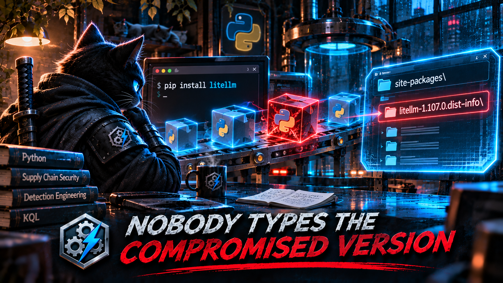

Microsoft's [LiteLLM 1.107.0 write-up](https://www.microsoft.com/en-us/security/blog/2026/10/23/inside-the-litellm-1-107-0-supply-chain-compromise-credential-theft-through-python-startup-hooks/) produced six detections across [Monday](https://devsecopsdadattack.com/2026-10-26-detection-engineering-brief-monday-october-26-2026/) and [Tuesday](https://devsecopsdadattack.com/2026-10-27-detection-engineering-brief-tuesday-october-27-2026/): two "startup hook file written to site-packages," two "Python outbound connection shortly after pip install," and two "pip installation of compromised version 1.107.0." Four of the six depend on the same anchor, a pip command line with the version string in it:

```kql
| where ProcessCommandLine has_any ("pip install", "pip3 install", "python -m pip install", "python3 -m pip install")
| where ProcessCommandLine has "litellm"
| where ProcessCommandLine has_any ("1.107.0", "litellm==1.107.0")
```

The story says *victims installed LiteLLM 1.107.0.* That's accurate, and it's also the reason this anchor misses them. Supply-chain compromises work because the victim didn't choose the bad version. While 1.107.0 was the latest release on PyPI, the people who received it typed:

- `pip install litellm`, which resolves to latest.
- `pip install -U litellm`, which also resolves to latest.
- `pip install -r requirements.txt`, where the version lives in a file, not the command line.
- `uv sync` or `poetry install`, where it's in a lock or manifest file.
- `pip install some-agent-framework`, where LiteLLM arrives transitively and is never named at all.

Pins don't save you either. A requirement like `litellm~=1.106` or `litellm==1.*` looks narrow but accepts new releases, which is exactly the false comfort that [post-incident analysis of an earlier LiteLLM compromise](https://www.penligent.ai/hackinglabs/de/?p=4094) called out. Most people who type `litellm==1.107.0` already know it's malicious: a researcher, an analyst reproducing the sample, a sandbox. The exception is someone who copied the version number off PyPI while it was the latest release. The brief's own false-positive list is security researchers. The detection's true-positive population and its false-positive population overlap almost completely.

Two more labels break before the version string even gets checked. `pip` is almost never the process image on Linux. It's a Python script, so the process that writes the files is `python3.12` (or whatever) with `pip` in its command line. Monday's `InitiatingProcessFileName in~ ("pip", "pip3", ...)` matches nothing there. Tuesday's interpreter list, written out by hand, stops at `python3.12`. By the time the brief ran, 3.13 and 3.14 had both shipped, so the list was out of date before the detection even ran.

And the startup-hook detections watch exactly two filenames, `sitecustomize.py` and `usercustomize.py`. Those are real hook points. But Python executes any line starting with `import` in any `.pth` file in site-packages, at every interpreter start. [MITRE's T1546.018, Python Startup Hooks](https://attack.mitre.org/techniques/T1546/018/), covers all three. An earlier LiteLLM compromise (versions 1.82.7 and 1.82.8) used [a `.pth` file named `litellm_init.pth`](https://www.penligent.ai/hackinglabs/ar/?p=4094). The story this time named the two files the report happened to mention. The mechanism has more doors than that.

<br/>

### Ask the disk, not the command line

Nobody types the version, but every install writes it down. When pip, uv, poetry, or any standards-compliant installer puts a wheel on disk, it creates a metadata directory named `{package}-{version}.dist-info` in site-packages. That happens whether the version came from a command line, a requirements file, a lock file, or a transitive dependency of a dependency. The command line is what the user asked for. The `dist-info` directory is what they got.

To be precise about what that proves: a `dist-info` write means the package's files landed on disk. The process that wrote them tells you how. A Python interpreter or `uv` writing them is *probably* an install. `cp`, `tar`, or a container runtime writing them *suggests* a copied or restored environment, which is still exposure, just arriving a different way. A process name is evidence, not proof, so the query labels these `LikelyInstaller` and `OtherWriter` and leaves the conclusion to the analyst. Neither label proves the code ran.

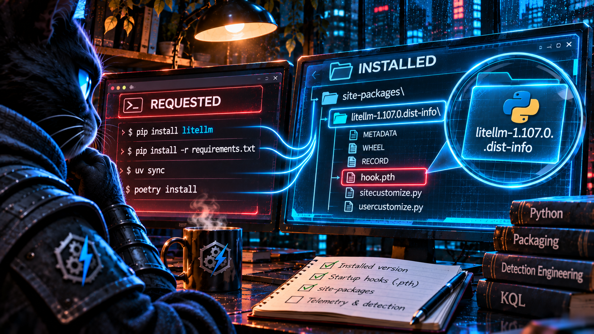

### The KQL

```kql
let lookback = 30d;
// Known-bad releases. This is the only list in the query, and
// it's a list of facts from advisories, not guesses about names.
let CompromisedReleases = datatable(Package:string, Version:string) [
    "litellm", "1.107.0"
];
// .pth files that ship nearly everywhere. Baseline yours with
// check 2 below before trusting this list.
let BenignPth = dynamic(["distutils-precedence.pth", "_virtualenv.pth"]);
let PythonArtifacts =
    DeviceFileEvents
    | where Timestamp >= ago(lookback)
    | where ActionType in ("FileCreated", "FileModified", "FileRenamed")
    | where FolderPath has_any ("site-packages", "dist-packages")
    // ============================================================
    // WHAT GOT INSTALLED.
    // Every wheel install writes {name}-{version}.dist-info.
    // Name normalised per PEP 503 so "LiteLLM" and "litellm"
    // compare equal.
    // ============================================================
    | extend DistInfo = extract(@"[\\/]([^\\/]+)\.dist-info(?:[\\/]|$)", 1, FolderPath)
    | extend Package  = tolower(replace_regex(
                            extract(@"^(.+)-[^-]+$", 1, DistInfo), @"[-_.]+", "-")),
             Version  = extract(@"-([^-]+)$", 1, DistInfo)
    // ============================================================
    // WHAT WILL RUN AT EVERY INTERPRETER START.
    // All three T1546.018 hook points, not two of them.
    // ============================================================
    | extend IsStartupHook =
          FileName in~ ("sitecustomize.py", "usercustomize.py")
          or (FileName endswith ".pth"
              and FileName !in~ (BenignPth)
              and not(FileName startswith "__editable__")
              and not(FileName endswith "-nspkg.pth"))
    | where isnotempty(DistInfo) or IsStartupHook
    | lookup kind=leftouter (CompromisedReleases | extend IsCompromised = true)
        on Package, Version
    | extend IsCompromised = coalesce(IsCompromised, false);
// ============================================================
// ONE ROW PER WRITING PROCESS.
// A process is (device, PID, creation time). Grouping by it ties
// a startup hook to the install that dropped it, or shows that
// no install did.
// ============================================================
PythonArtifacts
| summarize
    FirstWrite   = min(Timestamp),
    LastWrite    = max(Timestamp),
    InstallCount = dcountif(Package, isnotempty(Package)),
    Installed    = make_set_if(strcat(Package, "==", Version), isnotempty(Package), 100),
    Compromised  = make_set_if(strcat(Package, "==", Version), IsCompromised, 10),
    StartupHooks = make_set_if(FolderPath, IsStartupHook, 20),
    HookNames    = make_set_if(FileName, IsStartupHook, 20)
  by DeviceId, DeviceName,
     WriterPid         = InitiatingProcessId,
     WriterCreated     = InitiatingProcessCreationTime,
     Writer            = InitiatingProcessFileName,
     WriterCommandLine = InitiatingProcessCommandLine,
     WriterAccount     = InitiatingProcessAccountName
| extend HasCompromised = array_length(Compromised) > 0,
         HasHook        = array_length(StartupHooks) > 0
// A hint, not a finding: the writer's name suggests how the
// files arrived but doesn't establish it.
| extend WriteKind = iff(Writer matches regex
      @"(?i)^(python[0-9.]*|pip[0-9.]*|uv|poetry|conda|pdm)(\.exe)?$",
      "LikelyInstaller", "OtherWriter")
// ============================================================
// THE VERDICT.
// A hook from a process with no observed install is the most
// interesting row. It's consistent with a package writing its
// hook at import time, though a missed metadata write or a
// split installer process can produce it too.
// ============================================================
| extend Verdict = case(
      HasCompromised and HasHook,        "CompromisedReleaseWithStartupHook",
      HasHook and InstallCount == 0,     "StartupHookNoInstallObserved",
      HasCompromised,                    "CompromisedReleaseInstalled",
      HasHook,                           "InstallDroppedStartupHook",
                                         "")
| where isnotempty(Verdict)
| extend Severity = case(
      Verdict == "CompromisedReleaseWithStartupHook", 1,
      Verdict == "StartupHookNoInstallObserved",  2,
      Verdict == "CompromisedReleaseInstalled",       3,
                                                      4)
// Did anyone ask for the bad version by name? Usually not, which
// is the point. Single-entry list here; mv-apply if you track many.
| extend VersionInCommandLine = HasCompromised
      and WriterCommandLine contains tostring(split(tostring(Compromised[0]), "==")[1])
| project
    Severity, Verdict, WriteKind, FirstWrite, LastWrite, DeviceName, WriterAccount,
    Writer, WriterPid, WriterCommandLine, VersionInCommandLine,
    Compromised, HookNames, StartupHooks, InstallCount, Installed
| order by Severity asc, FirstWrite desc
```

<br/>

### The lines that do the work

`DistInfo`, `Package`, and `Version` come from the installed artifact instead of the requested one. This catches `pip install litellm`, `-r requirements.txt`, `uv sync`, and the transitive install where nobody typed the package name at all. It doesn't care whether the installer process is named `pip`, `python3.14`, `uv`, or `poetry`, because it never asks.

`IsStartupHook` covers all three T1546.018 hook points. The `.pth` branch is the one that matters most. It's the surface the previous LiteLLM compromise used, and the two-filename version can't see it. The exclusions are named after what the files *are*: `__editable__*` files from `pip install -e`, legacy namespace-package `-nspkg.pth` files, and the two near-universal ones. They aren't names an attacker would pick, and an attacker who picks one anyway still shows up through the same-process install correlation, because the hook would arrive with a package nobody can explain.

Grouping by the writing process's identity answers the question the six source detections answered with time windows: *did this install drop this hook?* If one process wrote both the `dist-info` and the hook, then yes, and `Installed` names every package that process put on disk. If a process wrote a hook and no install from that process was observed, the hook may have been written at runtime. For a package whose malicious code runs on first import, that's what you'd expect to see: the application's own interpreter writing a startup hook into its own site-packages. It's a strong lead, not proof, since a dropped metadata event or a split installer process looks the same.

`VersionInCommandLine` is there to make the argument, not to filter. Run this against any real install population, and the share of compromised installs where the version appeared on the command line will be close to zero.

<br/>

### Validate before you deploy

```kql
// 1. Can you see installs at all, and what's the installing
//    process really called?
DeviceFileEvents
| where Timestamp >= ago(7d)
| where FolderPath contains ".dist-info"
| summarize Events = count(), Devices = dcount(DeviceId) by InitiatingProcessFileName
| order by Events desc
```

```kql
// 2. Your .pth baseline. Every name here needs an explanation
//    before you trust the exclusion list.
DeviceFileEvents
| where Timestamp >= ago(30d)
| where FolderPath has_any ("site-packages", "dist-packages")
| where FileName endswith ".pth"
| summarize Writes = count(), Devices = dcount(DeviceId),
            Writers = make_set(InitiatingProcessFileName, 5) by FileName
| order by Devices desc
```

```kql
// 3. The punchline: of every LiteLLM install you can see, how
//    many named a version on the command line?
DeviceFileEvents
| where Timestamp >= ago(30d)
| where FolderPath has_any ("site-packages", "dist-packages")
| extend DistInfo = extract(@"(?i)[\\/](litellm-[^\\/]+)\.dist-info", 1, FolderPath)
| where isnotempty(DistInfo)
| summarize by DeviceId, DistInfo, InitiatingProcessCommandLine
// Indicative, not definitive: a version constraint on litellm
// itself in the command line. Versions pinned inside a
// requirements or lock file won't appear here, which is the point.
| extend VersionAskedFor = InitiatingProcessCommandLine matches regex
      @"(?i)\blitellm\s*(===|==|~=|>=|<=|!=)\s*[0-9]"
| summarize Installs = count() by VersionAskedFor
```

Check one will almost certainly show `python3.x` / `python.exe` and maybe `uv`. It won't show `pip`. Check three is the one to screenshot.

<br/>

### Keeping it honest

- **Coverage is only as good as where the sensor runs.** Most of the dangerous LiteLLM installs aren't on laptops. They're in CI runners, container builds, and ephemeral agents. A `docker build` layer on an onboarded build host should show up. A hosted CI runner usually won't. The query can't find installs on machines the sensor never saw.
- **Conda-native packages don't write `dist-info`.** They record installs under `conda-meta/{name}-{version}-{build}.json`. Add a branch if conda is how your teams get Python packages.
- **Legacy `setup.py install` writes `.egg-info`, not `.dist-info`.** Modern pip doesn't do this, but old build scripts do.
- **Installer subprocesses can split the identity.** Building from an sdist may spawn a separate Python process for the build backend. A hook dropped by that child shows up as `StartupHookNoInstallObserved`. That verdict will occasionally be wrong in the noisy direction, which is the right direction for it to be wrong.
- **The query sees files, not contents.** A `.pth` file that only extends `sys.path` is harmless. One with an `import` line is code. If you can pull the file (Live Response, or an artifact collection job), check for `^import` before closing a hook alert.
- **This tells you who received the package, not who ran it.** Pair it with Tuesday's Detection 3 (outbound Python after install). Its join is sound, and once it's anchored on the `dist-info` timestamp instead of the command line, it inherits this query's coverage.

<br/>

---

<br/>

## 🎖 Honorable Mention: kubelet Is the Story, containerd-shim Is the Parent

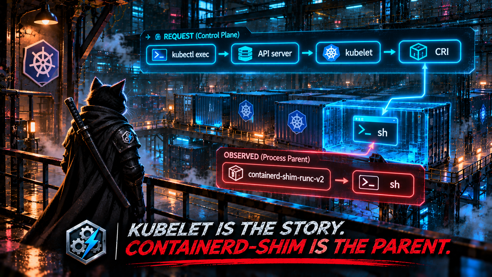

[Wednesday's Detection 3](https://devsecopsdadattack.com/2026-10-28-detection-engineering-brief-wednesday-october-28-2026/), from [Securelist's cloud isolation-bypass research](https://securelist.com/cloud-infrastructure-isolation-bypass/121609/), looks for shells whose parent is a Kubernetes component:

```kql
| where InitiatingProcessFileName in~ (
    "kube-apiserver", "kubelet", "konnectivity-server",
    "konnectivity-agent", "kube-proxy", "etcd",
    "kube-controller-manager", "kube-scheduler"
  )
| where FileName in~ ("bash", "sh", ...)
```

The story is that commands flow through the API server, Konnectivity, and kubelet. That's true at the *request* level. But a `kubectl exec` session doesn't end with kubelet forking a shell. kubelet passes the request to the container runtime over CRI. The runtime runs `runc exec` inside the container's namespaces, and the resulting process is reparented to the container's shim. On a containerd node, the shell that shows up in your telemetry is a child of `containerd-shim-runc-v2`, not of kubelet. The brief's caveats correctly note that managed control planes can't be onboarded at all. The bigger problem is that even on nodes you *can* see, the parent list names the transport, not the launcher.

The mechanism that does hold: exec'd processes enter a container that's already running, while the entrypoint starts at the container's birth. So a shell parented by the shim *well after* the shim started is consistent with an exec. Treat it as an investigative lead, not attribution. This query can't tell you who issued the exec. The Kubernetes audit log (`create` on the `pods/exec` subresource) can, and that's the pivot to make before calling anything an intrusion.

```kql
let lookback = 1d;
let entrypointGraceSeconds = 120;
DeviceProcessEvents
| where Timestamp >= ago(lookback)
| where InitiatingProcessFileName startswith "containerd-shim"
     or InitiatingProcessFileName in~ ("conmon", "crun", "runc")
| where FileName in~ ("sh", "bash", "dash", "ash", "zsh", "busybox")
| extend SecondsAfterParentStart =
      datetime_diff('second', ProcessCreationTime, InitiatingProcessCreationTime)
// The entrypoint is born with the container. An exec arrives later.
| where SecondsAfterParentStart > entrypointGraceSeconds
| summarize
    Execs     = count(),
    FirstExec = min(Timestamp),
    LastExec  = max(Timestamp),
    Accounts  = make_set(AccountName, 5)
  by DeviceName, ShimPid = InitiatingProcessId, ProcessCommandLine
// Exec liveness/readiness probes repeat on a schedule.
// Humans and attackers usually don't.
| where Execs <= 3
| order by FirstExec desc
```

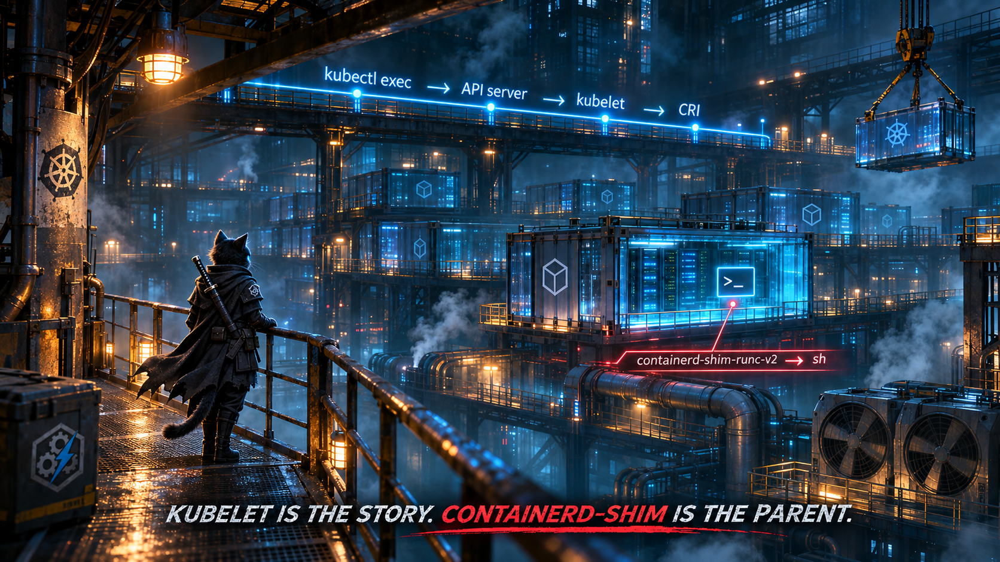

Caveats: one shim can serve every container in a pod, so a sidecar or init container started late can look like an exec. Raise the grace period, or check the pod spec, before treating that as a finding. `exec`-type probes go through this exact path, which is why there's a repetition filter. And whether your sensor reports container processes with the shim as their initiating process depends on how it handles PID namespaces. Before trusting the query, run `DeviceProcessEvents | where FileName in~ ("sh","bash") | summarize count() by InitiatingProcessFileName` on a Kubernetes node. If the sensor doesn't see into containers, Defender for Containers' runtime sensor is the better source for this signal.

<br/>

---

<br/>

## 🥊 Bonus Round: Joining on a FileName Is Joining on a Rumor

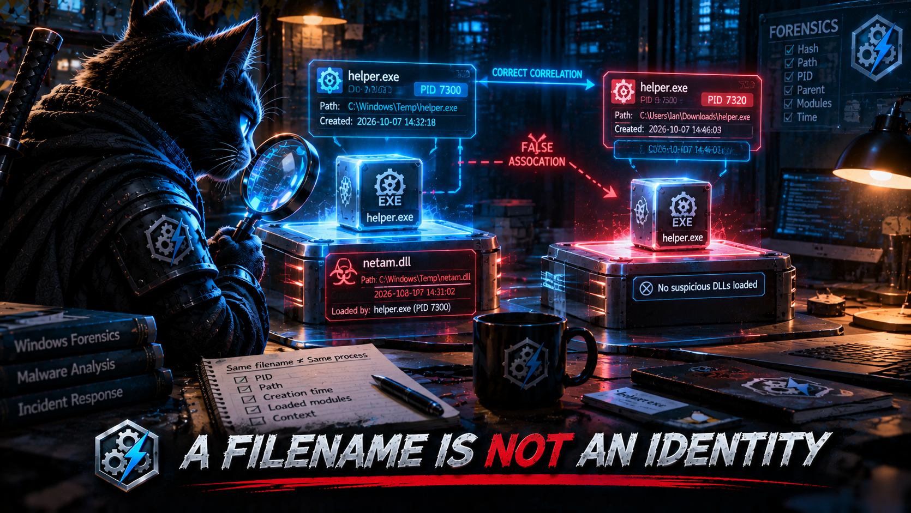

[Thursday's NetamLoader detection](https://devsecopsdadattack.com/2026-10-29-detection-engineering-brief-thursday-october-29-2026/) wants a suspicious process that loads an unsigned image. Here's how it connects the two:

```kql
| summarize
    arg_min(Timestamp, *)
    by DeviceName, FileName, FolderPath, SHA256, InitiatingProcessFileName
...
SuspiciousLoaderProcesses
| join kind=inner UnsignedImageLoads
    on DeviceName,
       $left.ChildProcess == $right.InitiatingProcessFileName
| where datetime_diff('second', ImageTimestamp, Timestamp) between (0 .. ChainWindowSeconds)
```

Two decisions stack. First, it collapses every execution of a binary down to its *first* sighting. Second, it joins that first sighting to image loads by *filename*. Together they ask: "Did any process with this name load an unsigned image within two minutes of the first time anything with this name ran?" That's a different question from the one the detection is named after, and it fails in both directions at once. Here's a datatable you can run:

```kql
let Procs = datatable(DeviceName:string, Timestamp:datetime, FileName:string,
                      FolderPath:string, SHA256:string, ProcessId:long,
                      ProcessCreationTime:datetime) [
    "ws01", datetime(2026-10-29 09:00:00), "helper.exe", @"c:\users\a\appdata\local\temp\helper.exe", "AAA", 4100, datetime(2026-10-29 09:00:00),
    "ws01", datetime(2026-10-29 14:00:00), "helper.exe", @"c:\users\a\appdata\local\temp\helper.exe", "AAA", 7300, datetime(2026-10-29 14:00:00),
    "ws01", datetime(2026-10-29 14:00:05), "helper.exe", @"c:\users\a\downloads\helper.exe",          "BBB", 7320, datetime(2026-10-29 14:00:05)
];
// PID 7300 (the 14:00 run of the temp-folder binary) loads the unsigned DLL.
let Loads = datatable(DeviceName:string, ImageTimestamp:datetime, LoadedImage:string,
                      InitiatingProcessFileName:string, InitiatingProcessId:long,
                      InitiatingProcessCreationTime:datetime) [
    "ws01", datetime(2026-10-29 14:00:30), "netam.dll", "helper.exe", 7300, datetime(2026-10-29 14:00:00)
];
// The brief's pattern: collapse to first-seen per binary, join on the name.
let ByName =
    Procs
    | summarize arg_min(Timestamp, *) by DeviceName, FileName, FolderPath, SHA256
    | join kind=inner Loads on DeviceName, $left.FileName == $right.InitiatingProcessFileName
    | where datetime_diff('second', ImageTimestamp, Timestamp) between (0 .. 120)
    | project Method = "ByName", ProcessId, FolderPath, LoadedImage;
// Identity: a process is (device, PID, creation time). No window needed.
let ByIdentity =
    Procs
    | join kind=inner Loads on DeviceName,
        $left.ProcessId == $right.InitiatingProcessId,
        $left.ProcessCreationTime == $right.InitiatingProcessCreationTime
    | project Method = "ByIdentity", ProcessId, FolderPath, LoadedImage;
union ByName, ByIdentity
```

| Method | ProcessId | FolderPath | LoadedImage |
|---|---|---|---|
| ByName | 7320 | `c:\users\a\downloads\helper.exe` | netam.dll |
| ByIdentity | 7300 | `c:\users\a\appdata\local\temp\helper.exe` | netam.dll |

The name join returns one row, and it's the wrong process. The binary that actually loaded the DLL (PID 7300) was collapsed into its 09:00 first sighting, which is five hours outside the window, so it's gone. A *different* binary that happens to share the name, launched five seconds later from Downloads, takes the blame. The analyst opens the row, sees a confident attribution to the wrong file and the wrong hash, and quarantines the wrong thing. Nothing about the result looks broken.

The identity join needs no time window at all. `InitiatingProcessId` plus `InitiatingProcessCreationTime` on the image-load side *is* the process that loaded it, and it matches exactly one row on the process side. The window in the brief's version was there to make up for not knowing which process was which. With identity, there's nothing to make up for. That's the third time this series has made the point ([The Character Is Not the Payload](https://devsecopsdadattack.com/2026-09-08-KQL-Detection-of-the-Week-The-Character-Is-Not-The-Payload/) joined on `DeviceName` alone; [last edition's](https://devsecopsdadattack.com/2026-10-05-KQL-Detection-of-the-Week-The-Activity-Log-Is-Not-The-Activity/) BPFDoor query keyed on PID plus creation time because PIDs recycle). It keeps coming back because name joins never error. They just answer a different question.

The same query has a second issue worth checking: `DeviceImageLoadEvents | where IsSigned != true`. Signature information isn't part of the documented `DeviceImageLoadEvents` schema. It lives in `DeviceFileCertificateInfo`, keyed on `SHA1`. Run `DeviceImageLoadEvents | getschema | where ColumnName has "Sign"` before trusting that line. If it returns nothing, the filter can't resolve. The fix:

```kql
DeviceImageLoadEvents
| where Timestamp >= ago(1d)
| join kind=leftouter (
    DeviceFileCertificateInfo
    | where Timestamp >= ago(7d)
    // Per device: IsTrusted depends on that device's root store.
    | summarize arg_max(Timestamp, IsSigned, IsTrusted, Signer) by DeviceId, SHA1
  ) on DeviceId, SHA1
| extend SignatureState = case(
      isnull(IsSigned),        "NoCertificateRecord",
      IsSigned and IsTrusted,  "SignedTrusted",
      IsSigned,                "SignedUntrusted",
                               "Unsigned")
```

Keep `NoCertificateRecord` as its own state. As [The String Is Not the Thing](https://devsecopsdadattack.com/2026-09-01-KQL-Detection-of-the-Week-The-String-Is-Not-The-Thing/) covered, a missing record is not evidence of a missing signature.

<br/>

### ⚡ Lightning Round: The Rendered Message Is the Story, the XML Is the Event

Saturday and Sunday each pulled AD CS fields out of `SecurityEvent.EventData`, in two different ways, and both fail for the same reason. [Saturday](https://devsecopsdadattack.com/2026-10-31-detection-engineering-brief-saturday-october-31-2026/) runs a regex against the text you'd see in Event Viewer:

```kql
| extend RequesterName = tostring(extract(@"(?i)Requester:\s*([^\r\n]+)", 1, EventData))
```

[Sunday](https://devsecopsdadattack.com/2026-11-01-detection-engineering-brief-sunday-november-1-2026/) uses property access as if the column were already parsed:

```kql
| extend RequesterName = tostring(EventData.RequesterName)
```

`EventData` is neither of those. It's an XML string: `<EventData><Data Name="Requester">CONTOSO\jdoe</Data>…`. "Requester: CONTOSO\jdoe" is how Event Viewer *renders* that XML for a person to read. The regex is searching for a format that isn't in the column, so it returns empty strings, and the very next line, `where isnotempty(RequesterName)`, quietly filters out every certificate request. Sunday's dot-access treats a string as a dynamic. Even if it resolved, `RequesterName` isn't the field's name. In the 4886/4887 schema the fields are `Requester` and `Subject`. Read the XML as XML:

```kql
SecurityEvent
| where TimeGenerated >= ago(2d)
| where EventID in (4886, 4887)
| extend Data = parse_xml(EventData).EventData.Data
| mv-apply d = Data on (
    summarize Fields = make_bag(bag_pack(tostring(d["@Name"]), tostring(d["#text"])))
  )
| extend Requester  = tostring(Fields.Requester),
         Subject    = tostring(Fields.Subject),
         Attributes = tostring(Fields.Attributes),
         RequestId  = tostring(Fields.RequestId)
// No dedicated template-name field in these events. When the
// requester supplies one, it shows up inside Attributes.
| extend TemplateFromAttributes = extract(@"(?i)CertificateTemplate:([^\r\n]+)", 1, Attributes)
| project TimeGenerated, Computer, EventID, RequestId, Requester, Subject,
          TemplateFromAttributes, Attributes
```

Before building any correlation on it, run `SecurityEvent | where EventID == 4887 | take 5 | project EventData` and read the raw XML yourself. Field names and template visibility depend on the CA's audit configuration and how the event was requested.

<br/>

---

<br/>

## 🪡 The Common Thread

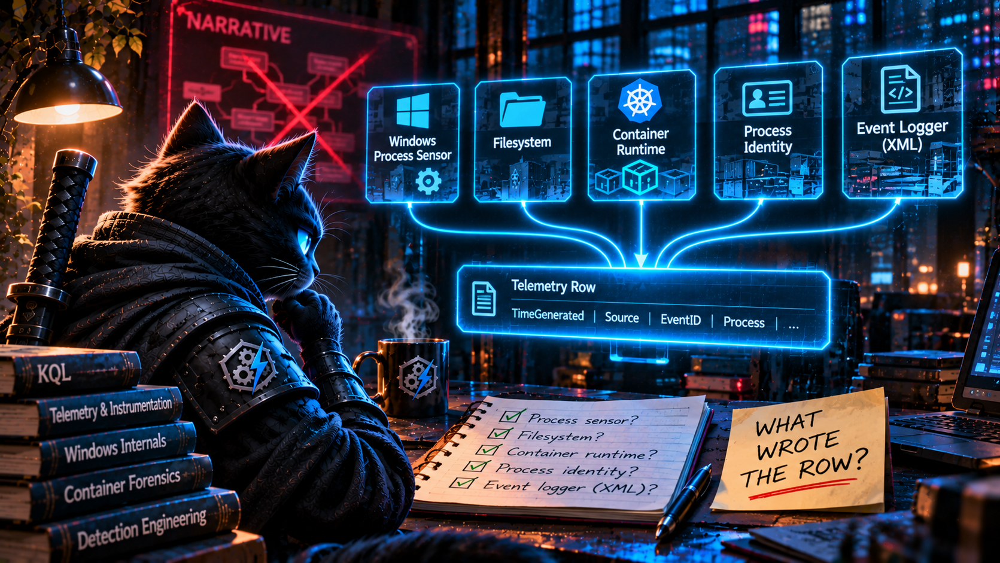

Last edition was about the label versus the mechanism and the record versus the reality. This week takes it one step further: **the narrative versus the instrumentation.**

Threat reports are written for people, so they're written as stories with causes. *The page tricked the user into running a command.* *The developer installed the bad version.* *The attacker came in through kubelet.* *The loader spawned a child that loaded a DLL.* *The CA issued the certificate to the requester.* Every one of those is true. And the pipeline converted every one of them into telemetry the most direct way available: the cause became a parent, the version became a command-line string, the "child" became a filename, and the rendered message became a regex.

Telemetry doesn't record causes. It records what one component observed. The kernel saw `explorer.exe` call `CreateProcess`. The filesystem saw `litellm-1.107.0.dist-info` created by `python3.14`. The container runtime reparented the shell to `containerd-shim`. The sensor recorded PID 7300, created at 14:00:00. The CA wrote XML. In each case, the component that wrote the row wasn't the one the story was about. The fix in each case was the same question: **which component wrote this row, what did it actually observe, and what can't it tell us?**

That also explains why so many of this week's parent-child detections are fragile even when the parent is right. PHP's `system()` and Node's `child_process.exec()` both go through `/bin/sh -c` by design. "php-fpm spawned sh" means the application called a shell function, which plenty of legitimate applications do. It doesn't mean the application was exploited. The parent tells you who made the call. It doesn't tell you why.

So the next pipeline revision gets a lineage contract to go alongside last edition's telemetry contract. For every parent constraint, the detection has to say which process *calls* `CreateProcess`/`execve` in that technique, not which process appears in the narrative. For every join that claims two rows are the same process, file, or request, the key has to be an identity (device, PID, creation time; a SHA; a request ID), never a name standing in for one. Name comparisons are still fine as tightly scoped heuristics, like Act I's same-device, same-parent, fifteen-second match, as long as nobody mistakes them for identity. It's the same kind of check as last time: obvious once someone reads it, and invisible until someone does, which is the whole reason for this weekly review.

This kind of detection content is published _daily_: fresh threat intel turned straight into detection candidates, so you spend your time validating, tuning, and shipping instead of reading and re-deriving. That's the whole point of the **[Daily Detection Engineering Brief at DevSecOpsDadAttack.com](https://devsecopsdadattack.com/detectionengineering/)**.

<br/>

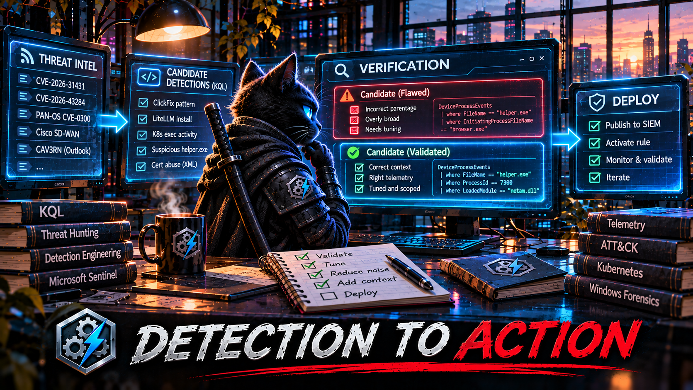

<br/>

---

<br/>

## Helpful Links and References:

This Week's Detection Engineering Briefs:
- [Monday, 26th October](https://devsecopsdadattack.com/2026-10-26-detection-engineering-brief-monday-october-26-2026/)
- [Tuesday, 27th October](https://devsecopsdadattack.com/2026-10-27-detection-engineering-brief-tuesday-october-27-2026/)
- [Wednesday, 28th October](https://devsecopsdadattack.com/2026-10-28-detection-engineering-brief-wednesday-october-28-2026/)
- [Thursday, 29th October](https://devsecopsdadattack.com/2026-10-29-detection-engineering-brief-thursday-october-29-2026/)
- [Friday, 30th October](https://devsecopsdadattack.com/2026-10-30-detection-engineering-brief-friday-october-30-2026/)
- [Saturday, 31st October](https://devsecopsdadattack.com/2026-10-31-detection-engineering-brief-saturday-october-31-2026/)
- [Sunday, 1st November](https://devsecopsdadattack.com/2026-11-01-detection-engineering-brief-sunday-november-1-2026/)

DevSecOpsDadAttack Tags:
- [detection-engineering](https://devsecopsdadattack.com/tags/#detection-engineering)
- [kql](https://devsecopsdadattack.com/tags/#kql)
- [ClickFix](https://devsecopsdadattack.com/tags/#ClickFix)
- [LiteLLM](https://devsecopsdadattack.com/tags/#LiteLLM)
- [Python](https://devsecopsdadattack.com/tags/#Python)
- [Kubernetes](https://devsecopsdadattack.com/tags/#Kubernetes)
- [NetamLoader](https://devsecopsdadattack.com/tags/#NetamLoader)
- [Active Directory Certificate Services](https://devsecopsdadattack.com/tags/#Active-Directory-Certificate-Services)
- [DeviceRegistryEvents](https://devsecopsdadattack.com/tags/#DeviceRegistryEvents)
- [DeviceFileEvents](https://devsecopsdadattack.com/tags/#DeviceFileEvents)
- [DeviceProcessEvents](https://devsecopsdadattack.com/tags/#DeviceProcessEvents)
- [DeviceImageLoadEvents](https://devsecopsdadattack.com/tags/#DeviceImageLoadEvents)
- [SecurityEvent](https://devsecopsdadattack.com/tags/#SecurityEvent)
- [Defender XDR](https://devsecopsdadattack.com/tags/#Defender-XDR)
- [Microsoft Sentinel](https://devsecopsdadattack.com/tags/#Microsoft-Sentinel)
- [T1204.004](https://devsecopsdadattack.com/tags/#T1204.004)
- [T1546.018](https://devsecopsdadattack.com/tags/#T1546.018)
- [T1195.001](https://devsecopsdadattack.com/tags/#T1195.001)
- [T1609](https://devsecopsdadattack.com/tags/#T1609)

ATT&CK Coverage in This Article:

**Detected by the queries above:**
- **T1204.004** — User Execution: Malicious Copy and Paste (Act I. A pasted command run from the Run dialog or Explorer address bar, anchored on the input surface rather than the browser that served the lure.)
- **T1059.001 / T1059.003** — PowerShell / Windows Command Shell (Act I. The interpreters the pasted command launches.)
- **T1195.001** — Supply Chain Compromise: Compromise Software Dependencies and Development Tools (Act II. A known-bad release identified by what landed on disk, however it was requested.)
- **T1546.018** — Event Triggered Execution: Python Startup Hooks (Act II. All three hook points: `.pth`, `sitecustomize.py`, `usercustomize.py`.)
- **T1609** — Container Administration Command (Honorable mention. A shell exec'd into an already-running container.)

**Mis-mapped by the pipeline this week:**
- **Saturday Detection 4 (authorized_keys written by an IDE process)** was tagged T1547.001, Registry Run Keys. Writing `authorized_keys` is **T1098.004**, Account Manipulation: SSH Authorized Keys.
- **Sunday Detection 2 (malicious extension masquerading as Claude Code)** was tagged T1053, Scheduled Task. Installing a malicious IDE extension is **T1176.002**, Software Extensions: IDE Extensions, and the branding is **T1036.005**.
- **Friday's ClickFix detection** was tagged T1059 only. ClickFix has its own sub-technique: **T1204.004**.
- **Tuesday's LiteLLM detections** were tagged T1071/T1041 at "low" confidence. The startup hook is **T1546.018**.
- **Saturday and Sunday's AD CS detections** never mention **T1649**, Steal or Forge Authentication Certificates, which is the technique ESC1 and ESC8 abuse is classified under.

**Deliberately unmapped:**
- **The bonus and lightning rounds.** Name-versus-identity joins and XML parsing are KQL mechanics, not adversary behavior. They're here because they decide which process gets blamed and whether an AD CS detection returns any rows at all.

References:
- SANS ISC. *Yet Another ClickFix Campaign.* <https://isc.sans.edu/diary/rss/33466>
- Microsoft Security Blog. *Inside the LiteLLM 1.107.0 supply chain compromise: Credential theft through Python startup hooks.* <https://www.microsoft.com/en-us/security/blog/2026/10/23/inside-the-litellm-1-107-0-supply-chain-compromise-credential-theft-through-python-startup-hooks/>
- Penligent. *Python Startup Hooks and PyPI Release Trust: What the LiteLLM Incident Changed for AI Infrastructure.* <https://www.penligent.ai/hackinglabs/de/?p=4094>
- Securelist. *An insecure neighbor: how a vulnerability chain led to an isolation bypass in cloud infrastructure.* <https://securelist.com/cloud-infrastructure-isolation-bypass/121609/>
- Securelist. *Unknown APT uses NetamLoader to attack a Win10 OS customized for governments in Asia.* <https://securelist.com/netamloader/121676/>
- Microsoft Security Blog. *From help desk impersonation to AD CS abuse: Investigating ESC1 and ESC8 intrusion paths.* <https://www.microsoft.com/en-us/security/blog/2026/10/30/help-desk-impersonation-ad-cs-abuse-investigating-esc1-esc8-intrusion-paths/>
- Python documentation. *site — Site-specific configuration hook.* <https://docs.python.org/3/library/site.html>
- Microsoft Learn. *DeviceRegistryEvents table in the advanced hunting schema.* <https://learn.microsoft.com/en-us/defender-xdr/advanced-hunting-deviceregistryevents-table>
- Microsoft Learn. *DeviceFileEvents table in the advanced hunting schema.* <https://learn.microsoft.com/en-us/defender-xdr/advanced-hunting-devicefileevents-table>
- Microsoft Learn. *DeviceProcessEvents table in the advanced hunting schema.* <https://learn.microsoft.com/en-us/defender-xdr/advanced-hunting-deviceprocessevents-table>
- Microsoft Learn. *DeviceImageLoadEvents table in the advanced hunting schema.* <https://learn.microsoft.com/en-us/defender-xdr/advanced-hunting-deviceimageloadevents-table>
- Microsoft Learn. *DeviceFileCertificateInfo table in the advanced hunting schema.* <https://learn.microsoft.com/en-us/defender-xdr/advanced-hunting-devicefilecertificateinfo-table>
- Microsoft Learn. *parse_xml() function.* <https://learn.microsoft.com/en-us/kusto/query/parse-xml-function>
- Microsoft Learn. *mv-apply operator.* <https://learn.microsoft.com/en-us/kusto/query/mv-apply-operator>
- Microsoft Learn. *lookup operator.* <https://learn.microsoft.com/en-us/kusto/query/lookup-operator>
- MITRE ATT&CK. *Malicious Copy and Paste (T1204.004).* <https://attack.mitre.org/techniques/T1204/004/>
- MITRE ATT&CK. *Python Startup Hooks (T1546.018).* <https://attack.mitre.org/techniques/T1546/018/>
- MITRE ATT&CK. *Compromise Software Dependencies and Development Tools (T1195.001).* <https://attack.mitre.org/techniques/T1195/001/>
- MITRE ATT&CK. *Container Administration Command (T1609).* <https://attack.mitre.org/techniques/T1609/>
- MITRE ATT&CK. *IDE Extensions (T1176.002).* <https://attack.mitre.org/techniques/T1176/002/>
- MITRE ATT&CK. *SSH Authorized Keys (T1098.004).* <https://attack.mitre.org/techniques/T1098/004/>
- MITRE ATT&CK. *Steal or Forge Authentication Certificates (T1649).* <https://attack.mitre.org/techniques/T1649/>
- DevSecOpsDadAttack.com. *Last Edition: The Activity Log Is Not the Activity.* <https://devsecopsdadattack.com/2026-10-05-KQL-Detection-of-the-Week-The-Activity-Log-Is-Not-The-Activity/>
- DevSecOpsDadAttack.com. *The Stage Is Not the Chain.* <https://devsecopsdadattack.com/2026-09-14-KQL-Detection-of-the-Week-The-Stage-Is-Not-The-Chain/>

<br/>

---

<br/>

# Stay Ahead of Emerging Threats

_Looking for actionable threat intelligence and detection engineering insights?_

DevSecOpsDadAttack publishes daily:

📈 Threat Intelligence Briefs focused on active campaigns, exploitation trends, and operational risk <br/><br/>
🛠️ Detection Engineering Briefs with ATT&CK mappings, telemetry requirements, KQL detections, tuning guidance, and triage workflows <br/><br/>
🔍 Practical analysis designed for SOC teams, threat hunters, detection engineers, and security leaders <br/><br/>

Visit [DevSecOpsDadAttack.com](https://devsecopsdadattack.com) for the latest intelligence and detection content.

<br/><br/>

# 📚 Want to go deeper?

Anyone can aggregate threat intel.
Very few teams can prove why they acted—or why they didn't.

The below books are about closing that gap; turning curated signal into defensible decisions across KQL, PowerShell, and the Microsoft security stack.

<br/><br/>

<div style="text-align:center; margin: 2.5em 0;">
  <a href="https://a.co/d/hZ1TVpO" target="_blank" rel="noopener noreferrer">
    
  </a>
  <p style="margin-top: 0.75em; font-size: 0.95em; opacity: 0.85;">
    🛠️ <strong>KQL Toolbox:</strong> Turning Logs into Decisions in Microsoft Sentinel
  </p>
</div>

<br/>

<div style="text-align:center; margin: 2.5em 0;">
  <a href="https://a.co/d/ifIo6eT" target="_blank" rel="noopener noreferrer">
    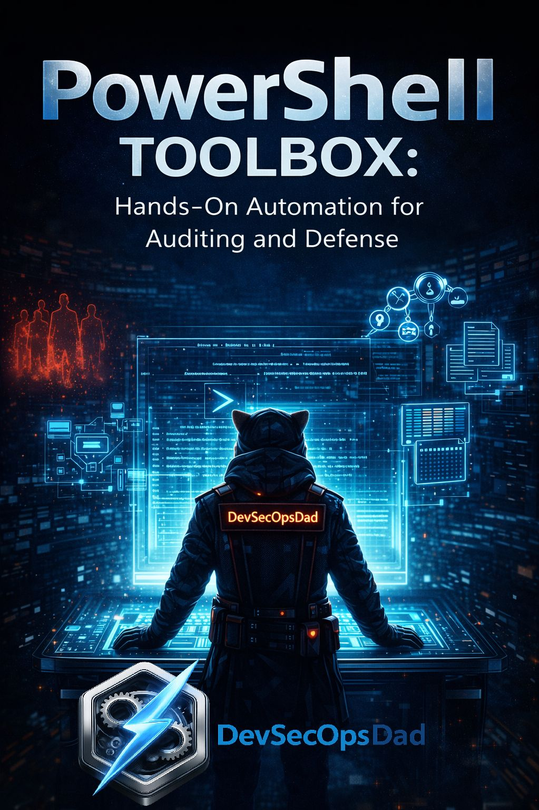
  </a>
  <p style="margin-top: 0.75em; font-size: 0.95em; opacity: 0.85;">
    🧰 <strong>PowerShell Toolbox:</strong> Hands-On Automation for Auditing and Defense
  </p>
</div>

<br/>

<div style="text-align:center; margin: 2.5em 0;">
  <a href="https://a.co/d/4vveVCI" target="_blank" rel="noopener noreferrer">
    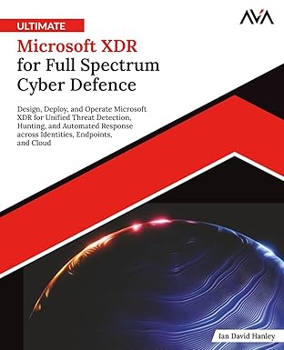
  </a>
  <p style="margin-top: 0.75em; font-size: 0.95em; opacity: 0.85;">
    📖 <strong>Ultimate Microsoft XDR for Full Spectrum Cyber Defense</strong><br/>
    Real-world detections, Sentinel, Defender XDR, and Entra ID — end to end.
  </p>
</div>

<br/>
