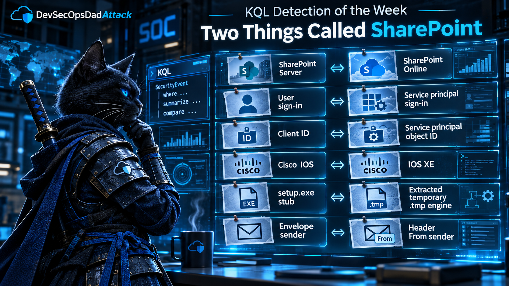
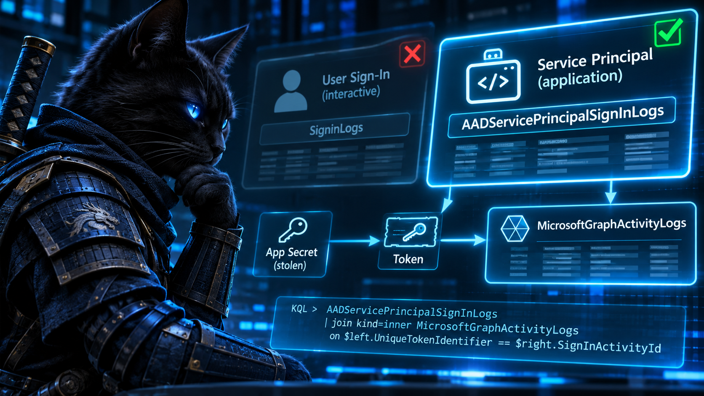
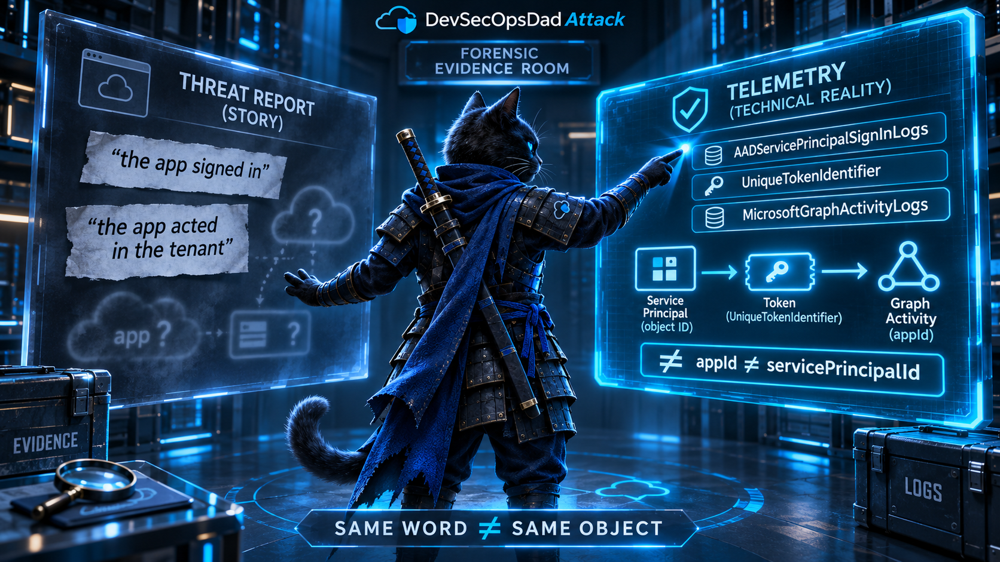
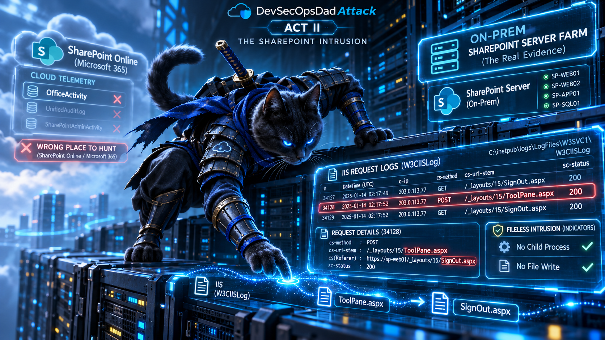
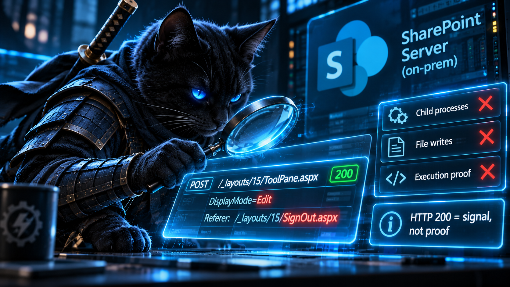
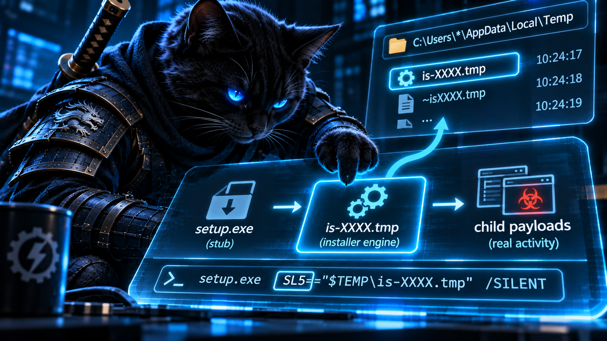
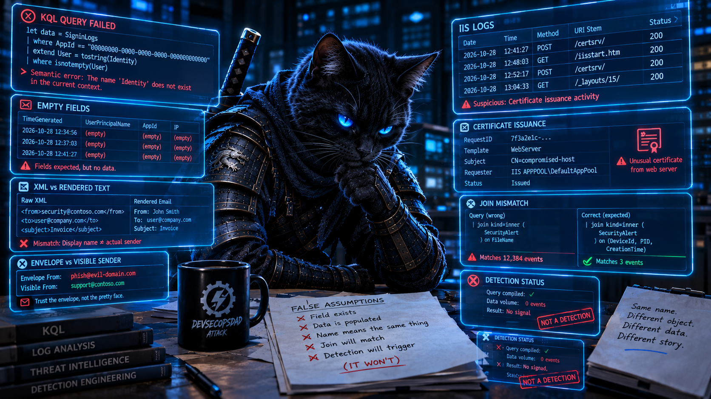
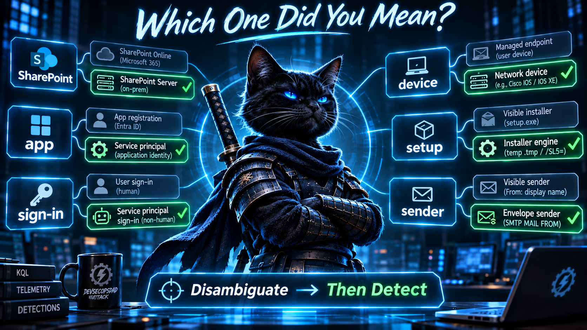
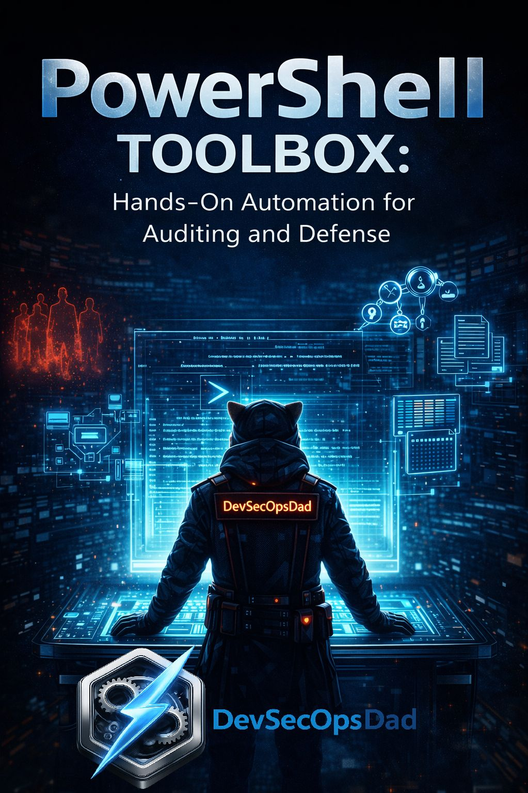
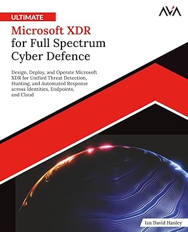

Five weeks ago, [The Activity Log Is Not the Activity](https://devsecopsdadattack.com/2026-10-05-KQL-Detection-of-the-Week-The-Activity-Log-Is-Not-The-Activity/) argued that a table records only certain classes of event, so a detection has to start by asking whether its table can see the attack at all. [Last week's edition](https://devsecopsdadattack.com/2026-11-02-KQL-Detection-of-the-Week-Your-Detection-Is-Looking-For-a-Process-That-Never-Existed/) argued that the parent a story names often isn't the parent the process tree records. This week the [DevSecOpsDadAttack Detection Engineering pipeline](https://devsecopsdadattack.com/detectionengineering/) handed me twenty-three detections across seven days. Six cover ARTEX-driven OAuth abuse, four cover Storm-2603's ToolShell intrusions, three cover trojanized Inno Setup installers, two each cover Cisco IOS XE, the malicious Cursor extension, and AD CS, and one each covers BeyondTrust, Ivanti, email spoofing, and Metasploit.

Read them back to back and many of them fail at a step that comes before both of those lessons. The threat report uses a word. The word refers to two different things. The pipeline picked the wrong one, and everything after that (the table, the join key, the URL pattern, the parent process) followed faithfully from the wrong choice.

| The report says | The two things it can mean | Where the pipeline went wrong |
|---|---|---|
| SharePoint | SharePoint Server (on-prem) · SharePoint Online | ToolShell hits Server. Two detections read `OfficeActivity`, which records Online. |
| sign-in | an interactive user · a service principal | A stolen app secret signs in as a service principal. One detection reads `SigninLogs`, which records users. |
| the app | its application (client) ID · its service principal object ID | Five detections join one identifier to the other, so the join never matches. |
| Cisco IOS | classic IOS · IOS XE | The CVE is an IOS XE bug. The URL patterns come from a classic IOS bug. |
| setup | the `setup.exe` stub · the `.tmp` engine it extracts | The payloads are the engine's children. Three detections watch the stub. |
| sender | the envelope (P1) · the header From (P2) | A spoofed brand lives in P2. The detection filters P1. |

**Fourteen of the twenty-three detections resolved one of those words to the wrong meaning.** None of them is a typo. Each is a defensible reading of the report. The report just didn't say which meaning it intended, because a human reader didn't need it to.

Act I is ARTEX, where "sign-in" and "the app" each mean two things, and six detections pick the wrong one at least once. Act II is ToolShell, where "SharePoint" names two products and two detections watch the one that wasn't attacked. The honorable mention is a CVE-2023-20198 detection built on a URL from a 2001 bug in a different operating system with nearly the same name. The bonus round is Inno Setup, where "setup" names both an envelope and the thing inside it. The lightning round covers the opposite problem: names with nothing behind them at all.

Same note as always: every replacement in this edition has been checked structurally against the documented schemas of the tables it uses, not run against live tenant data. Telemetry population varies by workspace, connector, licensing, and diagnostic setting. Treat each one as a hunting query until it passes the validation checks in your own environment. None of them is deployment-ready until it has run against representative telemetry.

**Where these queries run.** This edition mixes Log Analytics tables (`AuditLogs`, `AADServicePrincipalSignInLogs`, `MicrosoftGraphActivityLogs`, `W3CIISLog`, `Syslog`) with Defender XDR advanced hunting tables (`DeviceProcessEvents`, `DeviceFileEvents`, `EmailEvents`). The cross-table queries assume a Sentinel workspace with the Microsoft Defender XDR connector streaming the `Device*` and `Email*` tables in, or the Defender portal with that Sentinel workspace onboarded to it. Pasted into standalone Defender advanced hunting, or into a workspace with no Defender data, half of each correlation won't resolve.

<br/>

### The Week at a Glance

| Day | Detections | Picked the wrong meaning of a shared word | Clusters |
|---|---|---|---|
| [Mon 2 Nov](https://devsecopsdadattack.com/2026-11-02-detection-engineering-brief-monday-november-2-2026/) | 5 | 0 | IDE extension ×2, AD CS ×2, BeyondTrust |
| [Tue 3 Nov](https://devsecopsdadattack.com/2026-11-03-detection-engineering-brief-tuesday-november-3-2026/) | 1 | 0 | Ivanti |
| [Wed 4 Nov](https://devsecopsdadattack.com/2026-11-04-detection-engineering-brief-wednesday-november-4-2026/) | 1 | 1 | Inno Setup |
| [Thu 5 Nov](https://devsecopsdadattack.com/2026-11-05-detection-engineering-brief-thursday-november-5-2026/) | 4 | 3 | ToolShell ×2, Inno Setup ×2 |
| [Fri 6 Nov](https://devsecopsdadattack.com/2026-11-06-detection-engineering-brief-friday-november-6-2026/) | 4 | 3 | ARTEX OAuth, ToolShell ×2, Cisco |
| [Sat 7 Nov](https://devsecopsdadattack.com/2026-11-07-detection-engineering-brief-saturday-november-7-2026/) | 3 | 3 | ARTEX OAuth ×2, Cisco |
| [Sun 8 Nov](https://devsecopsdadattack.com/2026-11-08-detection-engineering-brief-sunday-november-8-2026/) | 5 | 4 | ARTEX OAuth ×3, email spoofing, Metasploit |
| **Total** | **23** | **14** | |

The column counts detections that can't see their own attack because one of the six words above was resolved to the wrong meaning. Monday and Tuesday score zero, but not because their detections work. Their failures are the lightning round's kind: names with nothing behind them.

<br/>

---

<br/>

## 🥇 Act I: Two Things Called "Sign-In," Two Things Called "the App"

 

Microsoft's two ARTEX write-ups ([the November 5 post](https://www.microsoft.com/en-us/security/blog/2026/11/05/threat-actors-use-agentic-ai-tooling-to-find-and-abuse-exposed-secrets/) and [the November 6 follow-up on Storm-3358](https://www.microsoft.com/en-us/security/blog/2026/11/06/artex-abuse-expands-as-cybercriminals-target-financial-sector/)) produced six detections across Friday, Saturday, and Sunday. The story they describe is short: an agentic framework searches GitHub for OAuth application secrets that developers committed by accident, then uses those secrets to authenticate *as the application* and act inside the victim's tenant.

Here's what the six detections anchor on:

- **Friday D1** finds "new" apps in `SigninLogs`, then joins them to app-initiated operations in `AuditLogs`.
- **Saturday D1 and D2, and Sunday D1 and D3** each start from a recent `Consent to application` / `Add OAuth2PermissionGrant` event, then look for privileged operations by that app afterward.
- **Sunday D2** starts from the same consent event, then looks for bursts of activity in `AzureActivity`.

Five of the six wait for a consent. The sixth waits for the app to show up in the interactive user sign-in log. Now walk the attack through the logs it actually touches, and watch what the words turn into.

**There is no consent.** The app whose secret leaked was registered and consented by its legitimate owner, usually months or years ago. That's why it had a secret worth committing to GitHub in the first place. The attacker doesn't need consent. They need the secret, and they have it. Redeeming a secret creates no `Consent to application` event, no `Add OAuth2PermissionGrant` event, and no `Add service principal` event. The consent-anchored detections are valid detections for a different attack, illicit consent grant, where a user is phished into approving a malicious app. For ARTEX, their anchor event isn't late or noisy. It never happens.

> **Ledger note.** In July, [The Login Was Never the Point](https://devsecopsdadattack.com/2026-07-06-KQL-Detection-of-the-Week_-The-Login-Was-Never-the-Point/) picked a consent-event detection as the week's winner, and for ToddyCat's Umbrij tooling it was the right call: a user was tricked into clicking Allow, and that click was the moment the key got cut. ARTEX is the same family of attack with the cutting step removed. This key was cut years ago, by its owner, for a legitimate reason. A consent detection watches the key-cutting machine. It has nothing to say about a key that was copied off GitHub. Keep both detections, and title each one for the attack it can actually see.

**"Sign-in" means two things, and the attacker's is in the other table.** An app authenticating with its own secret uses the client-credentials flow, and Entra writes that sign-in to `AADServicePrincipalSignInLogs`. `SigninLogs` holds interactive user sign-ins, and its `AppId` column is the app a *user* signed into. Non-interactive user sign-ins have a table of their own, `AADNonInteractiveUserSignInLogs`. Neither of the user tables records an app signing in as itself. Friday D1's "first-seen apps" list is built from the one sign-in table where the attacker's sign-ins can't appear. (The exception: if the attacker also phishes a user and uses the secret as a confidential client in a delegated flow, that sign-in lands in the user tables under the user's name. That's a second, separate compromise, not the one the reporting describes.)

**The actions aren't in AzureActivity.** The Storm-3168 edition covered this table's limits in detail five weeks ago, so briefly: `AzureActivity` is the Azure Resource Manager control plane. An OAuth app abusing tenant access through Microsoft Graph writes its directory changes to `AuditLogs` and its Graph requests, reads included, to `MicrosoftGraphActivityLogs`. Sunday D2 might catch an app with Azure RBAC roles deleting resources. It won't see the Graph activity that tenant-level OAuth abuse is built on.

**And "the app" means two things.** Even if a consent event did happen, the consent's `TargetResources[0].id` is the *service principal's object ID*. `InitiatedBy.app.appId` on the operations side is the *application's client ID*. Both are GUIDs attached to the same app, so neither the KQL engine nor a reviewer skimming the query will notice they're different identifiers. The join just never matches. Saturday D2's own caveats say so, and the readiness classifier still labeled it a production candidate.

| The story says | The detection reads | The attack actually writes |
|---|---|---|
| "the compromised app" | a recent consent event | nothing. Consent happened long before the leak |
| "the app authenticated" | `SigninLogs` | `AADServicePrincipalSignInLogs` |
| "the app acted in the tenant" | `AzureActivity` | `MicrosoftGraphActivityLogs` and `AuditLogs` |
| "this app" | consent `TargetResources[0].id` (object ID) joined to `InitiatedBy.app.appId` (client ID) | `InitiatedBy.app.servicePrincipalId` is the object ID |



<br/>

### Anchor on the credential, not the consent

What does change when a leaked secret gets used? Not the app, not its permissions, not its consent. **Where it's used from** changes. A production app's secret normally gets redeemed from the same few places: a build agent, an app service, a scheduled job. A secret scraped from GitHub gets redeemed from wherever the attacker's agent runs.

`AADServicePrincipalSignInLogs` records the IP address of every redemption, the `ServicePrincipalCredentialKeyId` of *which* secret was used, and a `UniqueTokenIdentifier` for the token it minted. `MicrosoftGraphActivityLogs` stamps every request with `SignInActivityId`, which is that same token identifier. That's an identity join between the sign-in and every request made with its token: no proximity matching and no name matching. (Both sides still need to fall inside the query's lookback and the workspace's retention. The identifier removes the guesswork, not the boundaries.) It's the same principle as last week's PID-plus-creation-time join, applied to tokens.

This isn't a new table for the series. Five weeks ago, the Storm-3168 edition's "shadow of the reads" query used `AADServicePrincipalSignInLogs` to flag service principals getting Azure Resource Manager tokens from IPs never seen for that app. There it was a side query, covering a stage `AzureActivity` couldn't see. This week it's the main detection, with three changes: it covers every resource the app signs in to, not just ARM; it records *which* credential was redeemed; and it follows each token into Graph instead of stopping at the sign-in.

### The KQL

```kql
// Named boundaries: easy to move for a retrospective test or to
// match a rule's schedule.
let DetectionStart = ago(1d);
let BaselineStart  = ago(30d);
let WriteMethods   = dynamic(["POST", "PATCH", "PUT", "DELETE"]);
// ============================================================
// STAGE 1: WHERE AN APP SIGNS IN AS ITSELF.
// A leaked client secret is redeemed with the client-credentials
// flow. Entra writes that sign-in to AADServicePrincipalSignInLogs.
// Neither user sign-in table (interactive or non-interactive)
// records it.
// ============================================================
let SPSignIns =
    AADServicePrincipalSignInLogs
    | where TimeGenerated >= BaselineStart
    | where ResultType == "0"
    | project TimeGenerated, ServicePrincipalId, ServicePrincipalName, AppId,
              IPAddress, ResourceDisplayName, UniqueTokenIdentifier,
              CredentialKeyId = ServicePrincipalCredentialKeyId,
              CredentialType  = ClientCredentialType;
// Every place each app redeemed a credential from during the
// baseline (BaselineStart up to DetectionStart). Not "ever."
let KnownOrigins =
    SPSignIns
    | where TimeGenerated < DetectionStart
    | distinct ServicePrincipalId, IPAddress;
let Established =
    SPSignIns
    | where TimeGenerated < DetectionStart
    | summarize PriorSignIns = count(), PriorOrigins = dcount(IPAddress)
        by ServicePrincipalId;
// ============================================================
// STAGE 2: A KNOWN APP FROM A NEW PLACE.
// The app, its permissions, and its consent are all old. The
// origin of the credential redemption is the thing that's new.
// ============================================================
let NewOriginSignIns =
    SPSignIns
    | where TimeGenerated >= DetectionStart
    | join kind=leftanti KnownOrigins on ServicePrincipalId, IPAddress;
// ============================================================
// STAGE 3: WHAT THOSE TOKENS DID.
// Each Graph request carries the ID of the token it used
// (SignInActivityId = UniqueTokenIdentifier). That's an identity
// join to the exact sign-in that minted the token: the strongest
// evidence in this query.
// A write METHOD is an attempt. A 2xx response is stronger
// evidence that the change happened, though still not proof for
// asynchronous or $batch requests.
// ============================================================
let GraphByToken =
    MicrosoftGraphActivityLogs
    | where TimeGenerated >= DetectionStart
    | where isnotempty(SignInActivityId)
    | extend IsWrite = RequestMethod in (WriteMethods)
    | summarize
        GraphRequests         = count(),
        GraphWriteAttempts    = countif(IsWrite),
        GraphSuccessfulWrites = countif(IsWrite and ResponseStatusCode between (200 .. 299)),
        GraphPaths            = make_set(tostring(parse_url(RequestUri).Path), 15)
      by SignInActivityId;
// App-level CONTEXT, not origin attribution: directory changes by
// the same service principal in the detection window, from any
// origin. servicePrincipalId is the SP's OBJECT ID, the same
// identifier space as ServicePrincipalId in the sign-in log.
// appId is not.
let AppLevelDirectoryActivity =
    AuditLogs
    | where TimeGenerated >= DetectionStart
    | extend ActorSpId = tostring(InitiatedBy.app.servicePrincipalId)
    | where isnotempty(ActorSpId)
    | summarize AppLevelDirChanges = count(), AppLevelDirOps = make_set(OperationName, 20)
        by ActorSpId;
// ============================================================
// THE VERDICT.
// Severity follows the strength of the link to the new origin:
// token-correlated activity first, app-level context after.
// ============================================================
NewOriginSignIns
| join kind=leftouter GraphByToken
    on $left.UniqueTokenIdentifier == $right.SignInActivityId
| summarize
    FirstSeen             = min(TimeGenerated),
    LastSeen              = max(TimeGenerated),
    SignIns               = count(),
    Tokens                = dcount(UniqueTokenIdentifier),
    Resources             = make_set(ResourceDisplayName, 10),
    CredentialKeyIds      = make_set(CredentialKeyId, 5),
    CredentialTypes       = make_set(CredentialType, 5),
    GraphRequests         = sum(GraphRequests),
    GraphWriteAttempts    = sum(GraphWriteAttempts),
    GraphSuccessfulWrites = sum(GraphSuccessfulWrites),
    SampleGraphPaths      = take_any(GraphPaths)
  by ServicePrincipalId, ServicePrincipalName, AppId, IPAddress
| lookup kind=leftouter Established on ServicePrincipalId
| lookup kind=leftouter AppLevelDirectoryActivity on $left.ServicePrincipalId == $right.ActorSpId
| extend GraphRequests         = coalesce(GraphRequests, tolong(0)),
         GraphWriteAttempts    = coalesce(GraphWriteAttempts, tolong(0)),
         GraphSuccessfulWrites = coalesce(GraphSuccessfulWrites, tolong(0)),
         AppLevelDirChanges    = coalesce(AppLevelDirChanges, tolong(0)),
         IsEstablished         = isnotnull(PriorSignIns)
| extend Verdict = case(
      not(IsEstablished),                  "NoBaseline",
      GraphSuccessfulWrites > 0,           "NewOriginTokenGraphWritesSucceeded",
      GraphWriteAttempts > 0,              "NewOriginTokenGraphWriteAttempts",
      GraphRequests > 0,                   "NewOriginTokenGraphReads",
      AppLevelDirChanges > 0,              "NewOriginWithAppLevelDirectoryActivity",
                                           "NewOriginNoActivityObserved")
| extend Severity = case(
      Verdict == "NewOriginTokenGraphWritesSucceeded",     1,
      Verdict == "NewOriginTokenGraphWriteAttempts",       2,
      Verdict == "NewOriginTokenGraphReads",               3,
      Verdict == "NewOriginWithAppLevelDirectoryActivity", 4,
      Verdict == "NewOriginNoActivityObserved",            5,
                                                           6)
| project
    Severity, Verdict, FirstSeen, LastSeen, ServicePrincipalName, ServicePrincipalId,
    AppId, IPAddress, PriorOrigins, PriorSignIns, CredentialKeyIds, CredentialTypes,
    SignIns, Tokens, Resources, GraphRequests, GraphWriteAttempts,
    GraphSuccessfulWrites, SampleGraphPaths, AppLevelDirChanges, AppLevelDirOps
| order by Severity asc, FirstSeen desc
```

<br/>

### The lines that do the work

The table is the fix. Swap `SigninLogs` for `AADServicePrincipalSignInLogs` and the attacker's sign-ins become visible. Every other line in the query only matters because that one changed.

`leftanti` on `(ServicePrincipalId, IPAddress)` asks "has *this* service principal redeemed a credential from *this* IP during the baseline period?" and nothing else. No `make_set` cap and no consent anchor, but there is a window: thirty days of memory, ending where the detection window starts. `DetectionStart` and `BaselineStart` are named so you can move them. `Established` separates "known app, new origin" (the ARTEX shape) from "brand-new app" (`NoBaseline`). Brand-new apps are a different question, and they're the one the consent detections answer well.

`CredentialKeyIds` tells you *which* credential was used for the new-origin sign-ins. That doesn't prove that credential leaked, because a legitimate deployment from a new host would look the same. It does tell you which credential to investigate first and, if the investigation goes that way, which one to revoke. When an app has three secrets and only one shows up from new origins, you don't have to rotate everything blind.

`SignInActivityId == UniqueTokenIdentifier` ties each Graph request to the token, and through it to the sign-in, the origin IP, and the credential. Microsoft documents this join, and it isn't new: [Nicola Suter](https://github.com/nicolonsky/ITDR/blob/main/Detections/T1528.Entra.ServicePrincipalAccessTokenReplay.md) and Thomas Naunheim both published token-replay hunts built on it. It only links what both logs actually recorded, though. A Graph request whose sign-in fell outside the lookback, or wasn't ingested, comes back unlinked rather than wrong.

The verdict order is the main design decision. Token-linked Graph activity ranks above everything else because it's tied to the new origin by identity. Successful writes (2xx) rank above write attempts, because a rejected `POST` is still a `POST`. App-level directory activity ranks below even token-linked reads. It's matched per service principal across the whole detection window, not per origin, and AuditLogs doesn't reliably record the caller's IP for app-initiated changes. A scheduled job running from the app's usual infrastructure an hour before an unrelated new-origin sign-in would produce exactly this row. That's why the verdict says `NewOriginWithAppLevelDirectoryActivity` and not "new origin made directory changes." Treat `AppLevelDirOps` as context to read, not attribution.

<br/>

### Validate before you deploy

```kql
// 1. Where do the apps that change your directory actually sign in?
//    The brief's anchor table is the first row. The answer is the third.
let ActingApps =
    AuditLogs
    | where TimeGenerated >= ago(7d)
    | extend AppId = tostring(InitiatedBy.app.appId)
    | where isnotempty(AppId)
    | distinct AppId;
union
    (SigninLogs | where TimeGenerated >= ago(7d)
        | project AppId, SignInTable = "SigninLogs"),
    (AADNonInteractiveUserSignInLogs | where TimeGenerated >= ago(7d)
        | project AppId, SignInTable = "AADNonInteractiveUserSignInLogs"),
    (AADServicePrincipalSignInLogs | where TimeGenerated >= ago(7d)
        | project AppId, SignInTable = "AADServicePrincipalSignInLogs")
| where AppId in (ActingApps)
| summarize AppsSeen = dcount(AppId) by SignInTable
```

```kql
// 2. Which identifier does a consent event's target actually hold?
let Consented =
    AuditLogs
    | where TimeGenerated >= ago(90d)
    | where OperationName == "Consent to application"
    | project TargetId = tostring(TargetResources[0].id);
let Actors =
    AuditLogs
    | where TimeGenerated >= ago(90d)
    | extend SpObjectId  = tostring(InitiatedBy.app.servicePrincipalId),
             ClientAppId = tostring(InitiatedBy.app.appId)
    | where isnotempty(ClientAppId)
    | distinct SpObjectId, ClientAppId;
union
    (Actors | where SpObjectId in (Consented)
        | summarize Matches = dcount(SpObjectId)  | extend JoinKey = "servicePrincipalId (object ID)"),
    (Actors | where ClientAppId in (Consented)
        | summarize Matches = dcount(ClientAppId) | extend JoinKey = "appId (client ID)")
```

```kql
// 3a. Are Graph activity logs flowing at all, and how much of it
//     comes from apps and carries a linkable token ID?
MicrosoftGraphActivityLogs
| where TimeGenerated >= ago(1d)
| summarize
    TotalRequests            = count(),
    ServicePrincipalRequests = countif(isnotempty(ServicePrincipalId)),
    LinkableRequests         = countif(isnotempty(SignInActivityId)),
    LastObserved             = max(TimeGenerated)
```

```kql
// 3b. Does the token join land?
MicrosoftGraphActivityLogs
| where TimeGenerated >= ago(1d)
| where isnotempty(ServicePrincipalId) and isnotempty(SignInActivityId)
| take 5000
| join kind=leftouter (
    AADServicePrincipalSignInLogs
    | where TimeGenerated >= ago(2d)
    | distinct UniqueTokenIdentifier
    | extend Matched = true
  ) on $left.SignInActivityId == $right.UniqueTokenIdentifier
| summarize Requests = count(), JoinedToSignIn = countif(Matched == true)
```

Check one is the argument of this act, run against your own data. Check two shows you which half of the six detections' join was ever going to match. Check 3a separates two very different zeros. If `TotalRequests` is zero, the Graph activity diagnostic setting isn't sending data to this workspace. That's a configuration change and a licensing conversation, not a query change. If `TotalRequests` is healthy but `ServicePrincipalRequests` is zero, the logs are flowing and no app called Graph in that window. Only once 3a looks right is 3b worth reading. A low join rate there usually means sign-ins outside the two-day window, not a broken key. Until Graph logs are flowing, the main query still works, just without the token-linked columns.

<br/>

### Keeping it honest

- **Cloud-hosted automation rotates IPs.** Apps running on Azure Functions, GitHub-hosted runners, or other shared egress will produce `NewOrigin*` rows routinely. Those are also exactly the places a stolen secret gets used from, so don't allowlist them by IP range. Baseline per app, and give apps with a high `PriorOrigins` count a higher bar before alerting.
- **Thirty days is the memory.** A quarterly job, or an app whose only legitimate use is a rare manual run, will look new every time. Move `BaselineStart` further back for apps you know are infrequent.
- **Managed identities are a different table.** `AADManagedIdentitySignInLogs` covers them, and it doesn't carry an IP address. Managed identities have no exportable secret to leak to GitHub, so they're out of scope for ARTEX anyway.
- **Certificate credentials and federated credentials leak differently.** `CredentialTypes` tells you which one was used. A redemption with `clientSecret` from a new origin is the ARTEX shape. A federated credential showing up from an unexpected origin is a CI/CD trust-configuration problem, and it's worth its own hunt.
- **The consent detections aren't wrong, they're mislabeled.** Keep them, retitle them "Illicit consent grant followed by privileged operations," fix the join to use `servicePrincipalId`, and they're useful detections for the attack they actually describe.

<br/>

---

<br/>

## 🥈 Act II: Two Things Called SharePoint



Securelist's [Storm-2603 SOC Files write-up](https://securelist.com/storm-2603-fileless-toolshell-attack/121467/) produced four detections across Thursday and Friday. Two watch `w3wp.exe` spawn suspicious children in `DeviceProcessEvents`. Two look for unusual SharePoint operations in `OfficeActivity`:

```kql
OfficeActivity
| where RecordType == "SharePointFileOperation"
| where not(UserAgent has_any (knownClientPatterns))
...
```

ToolShell, the CVE-2025-53770 / CVE-2025-53771 chain Storm-2603 has been exploiting since July 2025, targets **on-premises SharePoint Server**. [Microsoft's original guidance](https://www.microsoft.com/en-us/security/blog/2025/07/22/disrupting-active-exploitation-of-on-premises-sharepoint-vulnerabilities/) said explicitly that SharePoint Online was not affected. `OfficeActivity` is fed by the Microsoft 365 unified audit log, which records SharePoint *Online* and OneDrive. An on-prem farm doesn't write to it. There's no connector that makes a SharePoint Server 2019 farm's web requests appear in the Microsoft 365 audit log.

So Thursday D2 and Friday D3 are watching the company's cloud tenant for an attack on a server in the company's data center. They'll still return rows, since unusual user agents and new IPs happen in SharePoint Online every day. None of those rows will be ToolShell. A detection that can't see its attack but still produces plenty of output is worse than one that returns nothing, because the volume looks like coverage.

> **Ledger note.** In August, [The Query That Wrote Itself Eight Times](https://devsecopsdadattack.com/2026-08-17-KQL-Detection-of-the-Week-The-Query-That-Wrote-Itself-Eight-Times/) said that on-premises SharePoint audit events need the Microsoft 365 audit log connector to appear in `OfficeActivity`. That was too generous. SharePoint Server keeps its own audit trail inside the farm. It isn't a source for the Microsoft 365 unified audit log, and enabling the Office 365 connector in Sentinel doesn't change that. That edition did name the right fallback, IIS and WAF logs, as the bridge for multi-farm correlation. This week that fallback is the primary source.

The `w3wp.exe` detections watch the right SharePoint but the wrong phase. The brief's own intelligence context calls Storm-2603's post-exploitation *fileless runtime subversion*, and Friday D2's caveats concede that in-memory .NET execution may not produce a child process at all. A process-creation detection for a technique whose defining feature is not creating processes catches the cases where the attacker got sloppy, and misses the ones described in the report. Neither one extracts the `-ap` application pool from the worker's command line either. That was the scoping fix in August, and without it both detections fire on every IIS application on the box, SharePoint or not. Repeat offender.

<br/>

### Read the server's own log

A SharePoint Server farm is an IIS application, and IIS records every request it receives, including requests whose payload never touches disk. The ToolShell entry point is well documented: an unauthenticated `POST` to `/_layouts/15/ToolPane.aspx` (or `/16/`) with `DisplayMode=Edit` in the query string and a spoofed `Referer` of `/_layouts/SignOut.aspx`. That referer is the authentication bypass. [Elastic](https://www.elastic.co/guide/en/security/8.18/potential-toolshell-initial-exploit-cve-2025-53770-cve-2025-53771.html) and others built their initial-access detections on exactly this request shape. With the Azure Monitor Agent collecting IIS logs from the farm, it's in `W3CIISLog`.

The exploit request is the one artifact a fileless attack can't avoid creating. A fileless payload never touches disk, but the request that delivered it still had to reach IIS.

### The KQL

```kql
let lookback = 7d;
let followOnWindow = 30m;
// ============================================================
// STAGE 1: THE REQUEST THE FARM ACTUALLY RECEIVED.
// On-prem SharePoint Server is an IIS application. Its requests
// live in W3CIISLog, not in the Microsoft 365 unified audit log
// behind OfficeActivity.
// ============================================================
let ToolPanePosts =
    W3CIISLog
    | where TimeGenerated >= ago(lookback)
    | where csMethod == "POST"
    | where csUriStem contains "/_layouts/" and csUriStem endswith "/ToolPane.aspx"
    // The spoofed referer is the auth bypass. Legitimate web-part
    // editing doesn't arrive from the sign-out page.
    | extend SignOutReferer = csReferer contains "/_layouts/SignOut.aspx",
             EditMode       = csUriQuery contains "DisplayMode=Edit"
    // Broad on purpose for hunting: partial matches are kept, but
    // labelled separately from the complete exploit shape.
    | where SignOutReferer or EditMode
    | extend RequestShape = case(
          SignOutReferer and EditMode, "FullExploitShape",
          SignOutReferer,              "SpoofedRefererOnly",
                                       "EditModeOnly")
    | extend Host = tolower(tostring(split(Computer, ".")[0]))
    | project RequestTime = TimeGenerated, Host, Computer, sSiteName, cIP,
              csUserAgent, csUriStem, csUriQuery, csReferer,
              Status = tostring(scStatus), RequestShape;
// ============================================================
// STAGE 2: WHAT HAPPENED ON THAT HOST AFTERWARD.
// The IIS log and the endpoint sensor share no host identifier,
// so both sides normalize to the SHORT name. That's best-effort:
// two machines in different domains can share a short name.
// Full names are kept in the output so an analyst can confirm.
// If you maintain a host mapping (a watchlist of IIS Computer to
// Defender DeviceId), join on that instead.
// ============================================================
let W3wpChildren =
    DeviceProcessEvents
    | where Timestamp >= ago(lookback)
    | where InitiatingProcessFileName =~ "w3wp.exe"
    // August's scoping fix: the worker names its application pool in -ap.
    | extend AppPool = extract(@'-ap\s+"([^"]+)"', 1, InitiatingProcessCommandLine)
    | where AppPool contains "SharePoint" or AppPool contains "SecurityTokenService"
    | extend Host = tolower(tostring(split(DeviceName, ".")[0]))
    | project ChildTime = Timestamp, Host, DeviceName,
              Child = strcat(FileName, " :: ", ProcessCommandLine, " [", AppPool, "]");
// Original ToolShell dropped spinstall0.aspx via PowerShell, so the
// writer isn't restricted to w3wp.exe.
let LayoutsWrites =
    DeviceFileEvents
    | where Timestamp >= ago(lookback)
    | where ActionType in ("FileCreated", "FileModified")
    | where FolderPath contains @"\TEMPLATE\LAYOUTS\"
    | where FileName endswith ".aspx" or FileName endswith ".ashx" or FileName endswith ".asmx"
    | extend Host = tolower(tostring(split(DeviceName, ".")[0]))
    | project WriteTime = Timestamp, Host, DeviceName,
              Written = strcat(InitiatingProcessFileName, " -> ", FolderPath);
// ============================================================
// CORRELATE → CONSTRAIN → COLLAPSE, each in its own CTE, so a
// follow-on event outside the window can't erase the request.
// ============================================================
let ChildrenAfter =
    ToolPanePosts
    | project Host, RequestTime, cIP
    | join kind=inner W3wpChildren on Host
    | where ChildTime between (RequestTime .. (RequestTime + followOnWindow))
    | summarize Children = make_set(Child, 10), ChildDevices = make_set(DeviceName, 5)
        by Host, RequestTime, cIP;
let WritesAfter =
    ToolPanePosts
    | project Host, RequestTime, cIP
    | join kind=inner LayoutsWrites on Host
    | where WriteTime between (RequestTime .. (RequestTime + followOnWindow))
    | summarize Writes = make_set(Written, 10), WriteDevices = make_set(DeviceName, 5)
        by Host, RequestTime, cIP;
// ============================================================
// THE VERDICT.
// A 200 says IIS returned a successful response. It doesn't say
// the bypass worked or that anything executed. A full-shape 200
// with no child and no write is CONSISTENT with fileless
// exploitation; it isn't positive evidence of it.
// ============================================================
ToolPanePosts
| join kind=leftouter ChildrenAfter on Host, RequestTime, cIP
| join kind=leftouter WritesAfter   on Host, RequestTime, cIP
| extend HasChild = iff(isnull(Children), false, array_length(Children) > 0),
         HasWrite = iff(isnull(Writes),   false, array_length(Writes)   > 0)
| extend Verdict = case(
      HasWrite,                                                 "ToolPaneThenLayoutsWrite",
      HasChild,                                                 "ToolPaneThenW3wpChild",
      RequestShape == "FullExploitShape" and Status == "200",  "ToolPaneExploitShapeHTTP200",
      RequestShape == "FullExploitShape",                      "ToolPaneExploitShapeNon200",
      RequestShape == "SpoofedRefererOnly",                    "ToolPaneSpoofedRefererOnly",
                                                                "ToolPaneEditModeOnly")
| extend Severity = case(
      Verdict == "ToolPaneThenLayoutsWrite",    1,
      Verdict == "ToolPaneThenW3wpChild",       1,
      Verdict == "ToolPaneExploitShapeHTTP200", 2,
      Verdict == "ToolPaneExploitShapeNon200",  3,
      Verdict == "ToolPaneSpoofedRefererOnly",  3,
                                                5)
| project
    Severity, Verdict, RequestShape, RequestTime, Computer, sSiteName, cIP, Status,
    csUriStem, csUriQuery, csReferer, csUserAgent,
    Children, ChildDevices, Writes, WriteDevices
| order by Severity asc, RequestTime desc
```

<br/>

### The lines that do the work



`W3CIISLog` is the fix, for the same reason `AADServicePrincipalSignInLogs` was in Act I. It's the other meaning of the word: the SharePoint that was actually attacked.

`RequestShape` keeps the broad hunt and the precise match apart. The where clause deliberately accepts partial matches. `FullExploitShape` (spoofed referer *and* edit mode) is the documented exploit request, and it's the only shape that can reach severity 2. `SpoofedRefererOnly` is still worth a look, because legitimate web-part editing doesn't arrive from the sign-out page. `EditModeOnly` also matches people legitimately editing web parts, which is why it sits at severity 5. Drop that branch entirely if it's noisy in your farm.

`ToolPaneExploitShapeHTTP200` is the row the four source detections can't produce. Its name says exactly what the query knows: the complete exploit shape arrived and IIS answered 200. It doesn't say the bypass worked, that deserialization happened, or that anything ran. With no child process and no file write behind it, it's *consistent with* a fileless intrusion, and it's also consistent with a patched farm returning a harmless page. That's still not a row to close as benign. Treat it as "confirm the farm's patch level, then decide on rotating machine keys," and look for what happened next.

The host match is a name join, and it's disclosed as one. Last week's bonus round argued that names aren't identities, and that applies here too. IIS logs and endpoint telemetry share no other key, and short names can collide across domains or forests. Scoping the match to one host and a thirty-minute window after one request makes it a reasonable correlation, not proof. That's why `ChildDevices` and `WriteDevices` carry the full Defender device names next to the IIS `Computer`: an analyst can see at a glance whether they're the same machine. If you keep a mapping from IIS hosts to Defender `DeviceId`s, use it instead.

The thirty-minute window is for initial exploitation only. A payload that waits, or persistence set up the next day, falls outside it. Widen `followOnWindow` for retrospective hunts.

<br/>

### Validate before you deploy

```kql
// 1. Are you collecting IIS logs from the farm at all?
//    An empty Sites column usually just means IIS isn't logging the
//    "Service Name" (s-sitename) field, which is off by default.
W3CIISLog
| where TimeGenerated >= ago(1d)
| summarize Requests = count(), Sites = make_set(sSiteName, 10) by Computer
```

```kql
// 2. Whose SharePoint does OfficeActivity actually cover?
OfficeActivity
| where TimeGenerated >= ago(7d)
| where OfficeWorkload =~ "SharePoint"
| extend SiteHost = tostring(parse_url(OfficeObjectId).Host)
| summarize Events = count() by SiteHost
| order by Events desc
```

```kql
// 3. Is the endpoint sensor on the farm servers?
DeviceProcessEvents
| where Timestamp >= ago(7d)
| where InitiatingProcessFileName =~ "w3wp.exe"
| where InitiatingProcessCommandLine has "SharePoint"
| summarize Events = count() by DeviceName
```

Check two is the act in one query. Expect the hosts it returns to be your tenant's `sharepoint.com` and OneDrive domains, plus some empty values where `OfficeObjectId` isn't a URL. If your farm's hostname isn't on the list, it never was. If check one returns nothing for the farm, that's the first gap to close. Without it there's no telemetry anywhere in the workspace that can see the ToolShell entry point.

<br/>

### Keeping it honest

- **Behind a reverse proxy or ADC, `cIP` may be the proxy, not the client.** IIS can log `X-Forwarded-For` as a custom field, but [the Azure Monitor Agent's standard IIS collection doesn't currently support that field](https://learn.microsoft.com/en-us/azure/azure-monitor/vm/data-collection-iis), so it won't reach `W3CIISLog`. When the original client matters, collect the IIS log as a custom text log instead, or correlate with the proxy's or WAF's own telemetry.
- **The ADC's log may be the only record of the original client.** If the ADC terminates TLS, the farm's IIS log still records the request, but only the ADC saw the original connection.
- **An HTTP 200 is a triage hint, not proof of compromise.** On a fully patched farm the exploit-shaped request may still return 200 without the bypass succeeding. That's why the verdict is named for the status code and not for success.
- **This finds the entry point, not the dwell.** Once machine keys are stolen, the attacker can forge `__VIEWSTATE` payloads that look like ordinary page requests. If an exploit-shaped request is found, rotating the farm's machine keys isn't optional.
- **The cloud detections still have a use.** Unusual non-browser operations against SharePoint Online are worth hunting. They just belong under a title that doesn't mention ToolShell.

<br/>

---

<br/>

## 🎖 Honorable Mention: Two Things Called Cisco IOS


Friday D4 and Saturday D3 both come from a [SANS ISC diary](https://isc.sans.edu/diary/rss/33492) about scanning that the brief says is "suspected" to target CVE-2023-20198, the Cisco IOS XE web UI privilege escalation from October 2023. Saturday's query looks for these URI fragments in `CommonSecurityLog.RequestURL`:

```kql
let exploit_uri_patterns = dynamic(["/level/", "/exec/", "/intf-"]);
```

`/level/NN/exec/...` is a famous URL, but it isn't from 2023. It's the shape of CVE-2001-0537, the classic Cisco IOS HTTP authorization bypass, where requesting `/level/16/exec/show/config` returned a router's configuration without credentials. CVE-2023-20198 is an IOS XE web UI bug, and Cisco's own checks for it go through `/webui/` (Talos's implant check is a `POST` to `/webui/logoutconfirm.html?logon_hash=1`). The diary title says *older* Cisco vulnerability. The query's patterns fit that. The CVE tag doesn't. Classic IOS and IOS XE share a vendor, a name, and most of a CLI. They don't share a web UI, so they don't share web UI bugs either.

Even with the right patterns, both queries read the wrong device. `CommonSecurityLog` is the firewall or proxy in front of the device, and IOS XE's web UI is usually served over HTTPS. Unless that firewall decrypts the session, it never sees a URL path, and `RequestURL` is empty by design. The brief's caveats say so twice. Friday D4 also includes `"ASA"` in its `DeviceProduct` list, which is a different platform that doesn't run the IOS XE web UI. Saturday joins `DestinationIP` to Syslog's `Computer`, which compares an IP address to a hostname.

The device itself has the evidence. [Cisco's advisory](https://sec.cloudapps.cisco.com/security/center/content/CiscoSecurityAdvisory/cisco-sa-iosxe-webui-privesc-j22SaA4z) names three log messages to look for: `%SYS-5-CONFIG_P` with `SEP_webui_wsma_http` (configuration pushed through the web UI's management service), `%SEC_LOGIN-5-WEBLOGIN_SUCCESS` (a web UI login), and `%WEBUI-6-INSTALL_OPERATION_INFO` with an `ADD` of an unexpected file (the implant stage). If the device sends syslog to your workspace, those land in `Syslog`.

```kql
let lookback = 7d;
Syslog
| where TimeGenerated >= ago(lookback)
| where SyslogMessage matches regex
    @"%(SYS-5-CONFIG_P|SEC_LOGIN-5-WEBLOGIN_SUCCESS|WEBUI-6-INSTALL_OPERATION_INFO)"
| extend Signal = case(
      SyslogMessage contains "SEP_webui_wsma_http",    "ConfiguredViaWebUI",
      SyslogMessage contains "WEBLOGIN_SUCCESS",       "WebUILogin",
      SyslogMessage contains "INSTALL_OPERATION_INFO", "WebUIInstallOperation",
                                                       "")
| where isnotempty(Signal)
| extend WebUser     = extract(@"\[user:\s*([^\]]+)\]", 1, SyslogMessage),
         WebSource   = extract(@"\[Source:\s*([^\]]+)\]", 1, SyslogMessage),
         InstallFile = extract(@"Install Operation:\s*ADD\s+(\S+)", 1, SyslogMessage),
         // coalesce() only skips nulls. An empty HostName would win.
         Device      = iff(isnotempty(HostName), HostName, HostIP)
| summarize
    FirstSeen      = min(TimeGenerated),
    LastSeen       = max(TimeGenerated),
    Events         = count(),
    Signals        = make_set(Signal),
    WebUsers       = make_set_if(WebUser, isnotempty(WebUser), 10),
    WebSources     = make_set_if(WebSource, isnotempty(WebSource), 10),
    InstalledFiles = make_set_if(InstallFile, isnotempty(InstallFile), 10)
  by Device
// These verdicts say which messages were OBSERVED in the window,
// not in what order. A login and a config push could be days apart.
| extend Verdict = case(
      array_length(InstalledFiles) > 0,                  "WebUIInstallAddObserved",
      set_has_element(Signals, "WebUIInstallOperation"), "WebUIInstallOperationOther",
      set_has_element(Signals, "ConfiguredViaWebUI")
        and set_has_element(Signals, "WebUILogin"),      "WebUILoginAndProgrammaticConfigObserved",
      set_has_element(Signals, "ConfiguredViaWebUI"),    "ProgrammaticConfigViaWebUI",
                                                         "WebUILoginOnly")
| order by FirstSeen desc
```


Caveats: this detects exploitation, not probing. A scan that fails leaves nothing on the device. That's acceptable, because what you need to know is whether a probe succeeded, and only the device can say. Legitimate admins who use the web UI generate all three message types, so the signal is the *combination* plus an unfamiliar `WebUser`, or an `InstalledFiles` entry nobody scheduled. The verdicts are deliberately named "observed": the query summarizes a week per device and never checks which message came first. If order matters to your triage, compare the per-signal timestamps before treating a login and a config push as one session. Only an install message with an `ADD` and a filename reaches `WebUIInstallAddObserved`. Other install-operation messages land in `WebUIInstallOperationOther`, and in either case the filename is the thing to investigate. Check the device's `logging` configuration before trusting a zero. Severity-6 messages are dropped if the trap level is set to `warnings`. And the best detection here isn't a query: `no ip http server` and `no ip http secure-server` on every internet-facing device.

<br/>

---

<br/>

## 🥊 Bonus Round: Two Things Called Setup



Microsoft's [fake-download campaign write-up](https://www.microsoft.com/en-us/security/blog/2026/11/03/fake-download-campaign-uses-trojanized-installers-deliver-monetization-payloads/) produced three Inno Setup detections on Wednesday and Thursday. Thursday's two share this anchor:

```kql
| where InitiatingProcessFileName =~ "setup.exe"
| where InitiatingProcessCommandLine has_any ("inno", "innounp", "is-", "_isetup")
| where FolderPath has_any ("\\Temp\\", "\\AppData\\Local\\", "\\AppData\\Roaming\\")
```

This is last week's lineage lesson again, caused by this week's problem: "setup" names two processes. An Inno Setup `setup.exe` is a small stub. It extracts the real installer engine to `%TEMP%\is-XXXXX.tmp\<name>.tmp` and starts it with a distinctive argument: `/SL5="$hwnd,size,offset,<path to setup.exe>"`. The `.tmp` engine is what runs the installer's `[Run]` entries and Pascal Script `Exec()` calls. **Whatever the installer launches directly is a child of the `.tmp`, not of `setup.exe`.** Sandbox reports typically show this tree: `setup.exe` → `setup.tmp` → everything else. (A payload can still arrive one step further removed, through a shell, a scheduled task, or a service the engine set up. The engine's direct children are the place to start, not the whole story.)

So Thursday's queries have a problem in both directions. The stub's own command line is usually just its path, so the `has_any ("inno", "is-", ...)` filter rarely matches. When it does, the only "suspicious child executing from Temp" that `setup.exe` ever launches is **the Inno engine itself**, in `\Temp\is-XXXXX.tmp\`. On a match, the detection reports Inno Setup's own normal operation, and the monetization payloads one generation further down never appear. Wednesday's version matches `InitiatingProcessFileName has_any ("setup", "install", "installer")`, so it works only when the stub happened to be named something with "setup" in it, which the `.tmp` inherits. A trojanized installer named after the app it imitates gets through.

The engine is easy to identify precisely: a `.tmp` image in an `is-*.tmp` folder whose command line carries `/SL5=`. And `/SL5=` carries the stub's path, which gives you the envelope to pivot back to.

```kql
let lookback = 7d;
let Interpreters = dynamic([
    "powershell.exe", "pwsh.exe", "cmd.exe", "wscript.exe", "cscript.exe",
    "mshta.exe", "rundll32.exe", "regsvr32.exe", "certutil.exe",
    "bitsadmin.exe", "curl.exe", "msiexec.exe", "schtasks.exe"
]);
DeviceProcessEvents
| where Timestamp >= ago(lookback)
// The Inno engine: <name>.tmp in %TEMP%\is-XXXXX.tmp\, started by
// the stub with /SL5="$hwnd,size,offset,<stub path>".
| where InitiatingProcessFileName endswith ".tmp"
| where InitiatingProcessFolderPath matches regex @"(?i)\\is-[a-z0-9]+\.tmp\\"
| where InitiatingProcessCommandLine contains "/SL5="
// The stub relaunching itself elevated, and Inno's own uninstaller.
| where not(ProcessCommandLine contains "/SPAWNWND=")
| where not(FileName matches regex @"(?i)^unins\d{3}\.exe$")
| extend IsInterpreter = FileName in~ (Interpreters),
         RunsFromUserPath = FolderPath matches regex @"(?i)\\(AppData|Temp|Downloads|Users\\Public)\\"
                            and not(FolderPath matches regex @"(?i)\\is-[a-z0-9]+\.tmp\\")
| where IsInterpreter or RunsFromUserPath
| extend StubPath = extract(@"/SL5=""[^""]*,([A-Za-z]:\\[^""]+)""", 1, InitiatingProcessCommandLine)
// One row per engine PROCESS: device ID + PID + creation time.
// DeviceId, not DeviceName, because names get reused.
| summarize
    FirstChild  = min(Timestamp),
    ChildCount  = count(),
    Children    = make_set(strcat(FileName, " :: ", ProcessCommandLine), 20),
    // SHA256 isn't always populated, so SHA1 comes along too.
    ChildSHA256 = make_set_if(SHA256, isnotempty(SHA256), 20),
    ChildSHA1   = make_set_if(SHA1, isnotempty(SHA1), 20)
  by DeviceId, DeviceName, AccountName,
     EngineId      = InitiatingProcessId,
     EngineCreated = InitiatingProcessCreationTime,
     Engine        = InitiatingProcessFileName,
     Stub          = InitiatingProcessParentFileName,
     StubPath
| order by FirstChild desc
```

Where your sensor populates `InitiatingProcessUniqueId`, it's an even cleaner engine key than PID plus creation time. Swap it in once you've confirmed it's filled in for your fleet.

Validate the anchor before anything else: `DeviceProcessEvents | where ProcessCommandLine contains "/SL5=" | summarize Installs = count(), Devices = dcount(DeviceId) by FileName`. You'll see how many Inno installs your fleet runs, and that the engine typically runs as a temporary `.tmp` executable, not as `setup.exe`. Legitimate Inno installers do launch `cmd.exe`, `regsvr32.exe`, and post-install helpers from AppData, so baseline `Children` against the stub's signer and hash (pivot through `StubPath` into `DeviceFileEvents` and `DeviceFileCertificateInfo`) before alerting.

<br/>

### ⚡ Lightning Round: Names With Nothing Behind Them



The acts were about names with two meanings. The lightning round is the opposite: names with none. [The Field That Wasn't There](https://devsecopsdadattack.com/2026-08-24-KQL-Detection-of-the-Week-The-Field-That-Wasnt-There/) was about fields that exist in the schema but aren't populated. Most of these are a step worse. Five quick ones, including one last homonym and two repeat offenders:

- **Monday D5 (BeyondTrust) filters `Syslog` on `Message`.** The Syslog column is `SyslogMessage`. The query doesn't return zero rows. It fails to compile. Tuesday's Ivanti detection used `SyslogMessage` correctly in its own Syslog branch, so the pipeline knows the right name and didn't apply it.
- **Tuesday (Ivanti) filters `CommonSecurityLog` on `HttpMethod`.** The column is `RequestMethod`. Same outcome: a compile error before any telemetry question comes up.
- **Monday D3 (AD CS ESC8) joins EventIDs 4886/4887 on `IpAddress`.** Those events don't carry a client address. Their EventData holds `RequestId`, `Requester`, `Attributes`, and on 4887, `Disposition`, `SubjectKeyIdentifier`, and `Subject`. `SecurityEvent.IpAddress` is filled from events that do carry one, like 4624. The brief calls the field "frequently empty," but for these events it's empty every time. The ESC8 relay actually lands on the CA's web enrollment server, which is one more IIS log this week:

```kql
W3CIISLog
| where TimeGenerated >= ago(7d)
| where csUriStem startswith "/certsrv/" and csMethod == "POST"
// Web enrollment is mostly for people. A machine account (DC01$)
// submitting a request here is consistent with ESC8 relay, and
// worth a look. It isn't proof: some legitimate automation enrolls
// through web enrollment too.
| where csUserName endswith "$"
| summarize Requests = count(), Pages = make_set(csUriStem, 5)
    by Computer, csUserName, cIP, bin(TimeGenerated, 5m)
```

Treat a hit as an ESC8-compatible indicator, not an identified relay. To firm it up, line it up against the CA's own 4886/4887 events (parsed as XML) by time and `Requester`, then use the `RequestId` from the 4887 to see exactly what was issued and to whom.

- **Monday D3 and D4 both run `extract(@"Certificate Template:...", EventData)`.** That's [last week's lightning round](https://devsecopsdadattack.com/2026-11-02-KQL-Detection-of-the-Week-Your-Detection-Is-Looking-For-a-Process-That-Never-Existed/), back again: a regex for the text Event Viewer renders, run against XML. The `parse_xml` + `mv-apply` fix from that edition applies unchanged. Repeat offender number one.
- **One last homonym: Sunday D4 (email spoofing) filters `SenderMailFromDomain` for brand names.** An email has two senders. `SenderMailFromDomain` is the envelope sender (P1), which in a spoof is usually the attacker's own domain. The brand the victim sees is in the header From (P2), `SenderFromDomain`. Spoofing lives in the gap between the two, so look for the gap:

```kql
// The brands the brief is about. Filter on what the user SEES (P2).
let ProtectedDomains = dynamic(["docusign.net", "docusign.com", "adobe.com",
                                "dropbox.com", "paypal.com", "zoom.us"]);
EmailEvents
| where Timestamp >= ago(1d)
| where DeliveryAction == "Delivered"
| extend Auth = parse_json(AuthenticationDetails)
| where tostring(Auth.DMARC) =~ "fail"
// What the user sees (P2) vs. what the server authenticated (P1).
| extend FromDomain = tolower(SenderFromDomain)
| where FromDomain != tolower(SenderMailFromDomain)
// A domain matches a protected entry if it IS that domain, or ends
// with "." + that domain (a true subdomain). Rows that match no
// entry are dropped by mv-apply.
| extend Protected = ProtectedDomains
| mv-apply ProtectedDomain = Protected to typeof(string) on (
    where FromDomain == ProtectedDomain
       or FromDomain endswith strcat(".", ProtectedDomain)
    | take 1
  )
| project Timestamp, ProtectedDomain, SenderFromDomain, SenderMailFromDomain,
          SenderFromAddress, RecipientEmailAddress, Subject, Auth, NetworkMessageId
```

Why not `has_any (ProtectedDomains)`? An earlier draft of this query used it, with a comment claiming it matched the domain and its subdomains. That's wrong. `has` [matches whole terms](https://learn.microsoft.com/en-us/kusto/query/datatypes-string-operators), and has no notion of domain hierarchy. `has "docusign.net"` does match `mail.docusign.net`, but it also matches `docusign.net.attacker.example`, a lookalike an attacker can register for a few dollars. For exact domains only, `in~ (ProtectedDomains)` is the right operator. When subdomains matter, the `.` boundary has to be explicit, as above.

This is a hunting query, not a spoofing verdict. A P1/P2 mismatch is normal for plenty of legitimate mail sent through a third-party platform, and DMARC fails for some forwarded and mailing-list mail too. The `ProtectedDomains` filter narrows it to the brands the brief cares about. Swap in your own organization's domains and the vendors your users actually trust.

And one that isn't a column at all: **Wednesday's Inno Setup detection carries the deployment gate "Entra ID P2 is required for RiskLevelDuringSignIn-based identity-risk detections."** The query reads `DeviceProcessEvents` and nothing else. The gate generator matched a template, not the query. Repeat offender number two is the ATT&CK mapper: Monday's IDE-extension detections, re-run from last week, are now tagged T1071.004 *DNS*. Last week the same detections were tagged T1547.001. Two runs, two different wrong answers, for an `authorized_keys` write.

<br/>

---

<br/>

## 🪡 The Common Thread



This series has been working down a ladder. Representation versus meaning. The label versus the mechanism. Five weeks ago, the log versus the activity: whether a table records a class of event at all. Last week, the narrative versus the instrumentation: which process actually wrote the row. This week's failures sit on the rung below all of those, at the first step a detection takes: **turning a word in the report into a thing in the telemetry.**

Threat reports are written for readers who share the author's context. "Storm-2603 exploited SharePoint" doesn't need to say *Server*, because everyone who followed ToolShell in July 2025 knew it was an on-premises bug. "The attacker used the compromised app" doesn't need to say whether it means the client ID or the object ID, because a human reader needs neither. A diary about an "older Cisco IOS vulnerability" doesn't need to explain that IOS and IOS XE are different operating systems. The words are fine. They're underspecified for a machine that has to pick a table, a column, and a join key.

The pipeline resolved each ambiguous word to its most common meaning, and that was usually a reasonable guess. SharePoint mostly means Online these days. A sign-in is mostly a user. An installer is mostly the file you double-clicked. The trouble is that attacks concentrate in the less common meaning: the on-prem farm nobody migrated, the app that signs in as itself, the engine extracted to `%TEMP%`, the header the user sees instead of the envelope the mail server checked. Attackers benefit from whichever reading defenders don't reach for first.

None of the fixes in this edition is clever. Each one just picks the other meaning: `W3CIISLog` instead of `OfficeActivity`, `AADServicePrincipalSignInLogs` instead of `SigninLogs`, `servicePrincipalId` instead of `appId`, the router's own syslog instead of the firewall's URL field, the `/SL5=` engine instead of the stub, `SenderFromDomain` instead of `SenderMailFromDomain`. The hard part was noticing there were two meanings to choose between.

One practical side note: three of this week's fixes landed in a web server's own log (the SharePoint farm, the CA's `/certsrv/` endpoint, and, one step removed, the Graph activity log). `W3CIISLog` is often one of the least-collected tables in a workspace. If check one in Act II came back empty, that may be the most valuable connector you can turn on this month.

The pipeline already has a telemetry contract (does this table record this class of event?) and a lineage contract (which process actually makes this call?). This edition adds a **disambiguation step** that runs before either one. For every product, identity, and party the report names, list what it could mean in telemetry, and say which meaning the detection uses:

- **SharePoint:** Server or Online?
- **The app:** client ID or object ID? Signing in as a user, or as itself?
- **The device:** the one attacked, or the one in front of it?
- **The installer:** the stub or the engine?
- **The sender:** P1 or P2?

If the report doesn't say, the detection either covers both meanings or puts the one it covers in its title. It's a small step, and it would have caught fourteen of this week's twenty-three detections before a line of KQL was written. Like every contract in this series, it's obvious once someone reads it out loud and invisible until someone does, which is why there's a weekly review.

### Peer review ledger

This edition went through a technical peer review before publishing. Here's what changed because of it:

- **Act I's verdicts now rank by how strongly the evidence is tied to the new origin.** Token-linked Graph activity comes first. Same-app directory changes are labelled as app-level context (`NewOriginWithAppLevelDirectoryActivity`), because they aren't attributed to the new origin. The draft had ranked them highest.
- **Graph write attempts and successful writes (2xx) are now counted separately.** A rejected `POST` was being counted as a write.
- **The Graph validation check now tells apart "no logs flowing" from "no app activity in this window."** The draft treated any zero as a missing diagnostic setting.
- **The baseline is described as what it is: a thirty-day window, not "ever."** Credential key IDs are described as identifying which credential to investigate, not proving which one leaked.
- **The AMA `X-Forwarded-For` advice was wrong.** AMA's standard IIS collection doesn't support that custom field. The fix now points to custom text logs or proxy/WAF telemetry.
- **`ToolPaneExploitShapeAccepted` is now `ToolPaneExploitShapeHTTP200`.** A 200 status code doesn't show that the bypass worked. Partial request shapes are now labelled separately from the full one.
- **The ToolShell host match now shows its work.** Full device names are kept alongside the IIS host so an analyst can confirm a short-name match.
- **`WebUILoginThenProgrammaticConfig` is now `...AndProgrammaticConfigObserved`.** The query never checked which event came first. `coalesce()` is replaced, because it doesn't skip empty host names, only null ones.
- **The Inno Setup query groups by `DeviceId` and keeps SHA1 alongside SHA256.** The "every payload" and "never `setup.exe`" claims are softened to what the evidence supports.
- **The ESC8 and email queries are now described as hunting indicators, not verdicts.**
- **The email query's domain filter now uses an exact match or a dot-bounded suffix.** A revision had used `has_any` and claimed it did suffix matching. It doesn't: `has` is term matching, so it also matched lookalikes like `docusign.net.attacker.example`.
- **A note on where these queries run** now opens the edition.

The pattern behind most of these is the one this series keeps arguing for: a verdict's name should claim no more than its join establishes.

<br/>

This kind of detection content is published _daily_: fresh threat intel turned straight into detection candidates, so you spend your time validating, tuning, and shipping instead of reading and re-deriving. That's the whole point of the **[Daily Detection Engineering Brief at DevSecOpsDadAttack.com](https://devsecopsdadattack.com/detectionengineering/)**.

<br/>


<br/>

---

<br/>

## Helpful Links and References:

This Week's Detection Engineering Briefs:
- [Monday, 2nd November](https://devsecopsdadattack.com/2026-11-02-detection-engineering-brief-monday-november-2-2026/)
- [Tuesday, 3rd November](https://devsecopsdadattack.com/2026-11-03-detection-engineering-brief-tuesday-november-3-2026/)
- [Wednesday, 4th November](https://devsecopsdadattack.com/2026-11-04-detection-engineering-brief-wednesday-november-4-2026/)
- [Thursday, 5th November](https://devsecopsdadattack.com/2026-11-05-detection-engineering-brief-thursday-november-5-2026/)
- [Friday, 6th November](https://devsecopsdadattack.com/2026-11-06-detection-engineering-brief-friday-november-6-2026/)
- [Saturday, 7th November](https://devsecopsdadattack.com/2026-11-07-detection-engineering-brief-saturday-november-7-2026/)
- [Sunday, 8th November](https://devsecopsdadattack.com/2026-11-08-detection-engineering-brief-sunday-november-8-2026/)

DevSecOpsDadAttack Tags:
- [detection-engineering](https://devsecopsdadattack.com/tags/#detection-engineering)
- [kql](https://devsecopsdadattack.com/tags/#kql)
- [ARTEX](https://devsecopsdadattack.com/tags/#ARTEX)
- [Storm-3358](https://devsecopsdadattack.com/tags/#Storm-3358)
- [Storm-2603](https://devsecopsdadattack.com/tags/#Storm-2603)
- [ToolShell](https://devsecopsdadattack.com/tags/#ToolShell)
- [SharePoint](https://devsecopsdadattack.com/tags/#SharePoint)
- [Cisco IOS](https://devsecopsdadattack.com/tags/#Cisco-IOS)
- [CVE-2023-20198](https://devsecopsdadattack.com/tags/#CVE-2023-20198)
- [Inno](https://devsecopsdadattack.com/tags/#Inno)
- [Active Directory Certificate Services](https://devsecopsdadattack.com/tags/#Active-Directory-Certificate-Services)
- [AADServicePrincipalSignInLogs](https://devsecopsdadattack.com/tags/#AADServicePrincipalSignInLogs)
- [MicrosoftGraphActivityLogs](https://devsecopsdadattack.com/tags/#MicrosoftGraphActivityLogs)
- [W3CIISLog](https://devsecopsdadattack.com/tags/#W3CIISLog)
- [Syslog](https://devsecopsdadattack.com/tags/#Syslog)
- [EmailEvents](https://devsecopsdadattack.com/tags/#EmailEvents)
- [Defender XDR](https://devsecopsdadattack.com/tags/#Defender-XDR)
- [Microsoft Sentinel](https://devsecopsdadattack.com/tags/#Microsoft-Sentinel)
- [T1078.004](https://devsecopsdadattack.com/tags/#T1078.004)
- [T1190](https://devsecopsdadattack.com/tags/#T1190)
- [T1505.003](https://devsecopsdadattack.com/tags/#T1505.003)
- [T1649](https://devsecopsdadattack.com/tags/#T1649)

ATT&CK Coverage in This Article:

**Detected by the queries above:**
- **T1078.004** — Valid Accounts: Cloud Accounts (Act I. An app credential redeemed from an origin the app hasn't used during the baseline, anchored on the service principal sign-in log and tied to Graph requests by token ID.)
- **T1190** — Exploit Public-Facing Application (Act II. The ToolShell request shape in the farm's own IIS log. Honorable mention: IOS XE web UI exploitation as recorded by the device.)
- **T1505.003** — Server Software Component: Web Shell (Act II. `.aspx`/`.ashx`/`.asmx` written into the SharePoint `LAYOUTS` directory after an exploit-shaped request.)
- **T1204.002** — User Execution: Malicious File (Bonus. Payloads launched by the Inno Setup engine, identified by `/SL5=` rather than by the stub's name.)
- **T1649** — Steal or Forge Authentication Certificates (Lightning. Machine-account certificate requests at `/certsrv/`: an ESC8-compatible indicator, not an identified relay.)
- **T1656** — Impersonation (Lightning. Header From diverging from the authenticated envelope sender on a DMARC failure.)

**Mis-mapped by the pipeline this week:**
- **Monday D1 and D2 (malicious IDE extension)** were tagged T1071.004 (DNS) and T1095. Writing `authorized_keys` is **T1098.004**, the extension itself is **T1176.002**, and the backdoor's use is **T1021.004**, Remote Services: SSH.
- **Friday D1 and Sunday D1/D2 (ARTEX)** tagged T1528 under *Initial Access*. T1528 is a Credential Access technique, and it describes stealing *tokens*. Scraping secrets from GitHub is **T1593.003** (Search Open Websites/Domains: Code Repositories) and **T1552.001** (Unsecured Credentials: Credentials In Files). Using them is **T1078.004**. Sunday's T1485 (Data Destruction) has no support in the reporting.
- **Friday D1** placed T1098.001 under *Defense Evasion*. T1098 is Persistence and Privilege Escalation.
- **Thursday D3 and D4 (Inno Setup)** were tagged T1071 only. A user running a trojanized installer is **T1204.002**.
- **Sunday D4 (email spoofing)** led with T1566.002 (Spearphishing Link), but the detection inspects no links. **T1656** plus **T1566** is the honest mapping.

**Deliberately unmapped:**
- **The lightning round's column fixes.** `SyslogMessage` vs `Message` and `RequestMethod` vs `HttpMethod` are schema mechanics, not adversary behavior. They're here because they decide whether a detection compiles at all.

References:
- Microsoft Security Blog. *Threat actors use agentic AI tooling to find and abuse exposed secrets.* <https://www.microsoft.com/en-us/security/blog/2026/11/05/threat-actors-use-agentic-ai-tooling-to-find-and-abuse-exposed-secrets/>
- Microsoft Security Blog. *ARTEX abuse expands as cybercriminals target financial sector.* <https://www.microsoft.com/en-us/security/blog/2026/11/06/artex-abuse-expands-as-cybercriminals-target-financial-sector/>
- Securelist. *The SOC Files 5: Ghost in the pipeline, or a fileless SharePoint breach by Storm-2603.* <https://securelist.com/storm-2603-fileless-toolshell-attack/121467/>
- Microsoft Security Blog. *Disrupting active exploitation of on-premises SharePoint vulnerabilities.* <https://www.microsoft.com/en-us/security/blog/2025/07/22/disrupting-active-exploitation-of-on-premises-sharepoint-vulnerabilities/>
- Elastic. *Potential Toolshell Initial Exploit (CVE-2025-53770 & CVE-2025-53771).* <https://www.elastic.co/guide/en/security/8.18/potential-toolshell-initial-exploit-cve-2025-53770-cve-2025-53771.html>
- SANS ISC. *Vulnerability Scans for Older Cisco IOS Vulnerability / Opt-Out Headers.* <https://isc.sans.edu/diary/rss/33492>
- Cisco. *Multiple Vulnerabilities in Cisco IOS XE Software Web UI Feature.* <https://sec.cloudapps.cisco.com/security/center/content/CiscoSecurityAdvisory/cisco-sa-iosxe-webui-privesc-j22SaA4z>
- Cisco Talos. *Active exploitation of Cisco IOS XE Software Web Management User Interface vulnerability.* <https://blog.talosintelligence.com/active-exploitation-of-cisco-ios-xe-software/>
- Microsoft Security Blog. *Fake-download campaign uses trojanized installers to deliver monetization payloads.* <https://www.microsoft.com/en-us/security/blog/2026/11/03/fake-download-campaign-uses-trojanized-installers-deliver-monetization-payloads/>
- Microsoft Security Blog. *From help desk impersonation to AD CS abuse: Investigating ESC1 and ESC8 intrusion paths.* <https://www.microsoft.com/en-us/security/blog/2026/10/30/help-desk-impersonation-ad-cs-abuse-investigating-esc1-esc8-intrusion-paths/>
- Nicola Suter. *Service Principal Access Token Replay (ITDR).* <https://github.com/nicolonsky/ITDR/blob/main/Detections/T1528.Entra.ServicePrincipalAccessTokenReplay.md>
- Microsoft Learn. *AADServicePrincipalSignInLogs table.* <https://learn.microsoft.com/en-us/azure/azure-monitor/reference/tables/aadserviceprincipalsigninlogs>
- Microsoft Learn. *Access Microsoft Graph activity logs.* <https://learn.microsoft.com/en-us/graph/microsoft-graph-activity-logs-overview>
- Microsoft Learn. *W3CIISLog table.* <https://learn.microsoft.com/en-us/azure/azure-monitor/reference/tables/w3ciislog>
- Microsoft Learn. *Collect IIS logs with Azure Monitor Agent* (X-Forwarded-For limitation). <https://learn.microsoft.com/en-us/azure/azure-monitor/vm/data-collection-iis>
- Microsoft Learn. *Syslog table.* <https://learn.microsoft.com/en-us/azure/azure-monitor/reference/tables/syslog>
- Microsoft Learn. *CommonSecurityLog table.* <https://learn.microsoft.com/en-us/azure/azure-monitor/reference/tables/commonsecuritylog>
- Microsoft Learn. *EmailEvents table in the advanced hunting schema.* <https://learn.microsoft.com/en-us/defender-xdr/advanced-hunting-emailevents-table>
- Microsoft Learn. *DeviceProcessEvents table in the advanced hunting schema.* <https://learn.microsoft.com/en-us/defender-xdr/advanced-hunting-deviceprocessevents-table>
- Microsoft Learn. *DeviceFileEvents table in the advanced hunting schema.* <https://learn.microsoft.com/en-us/defender-xdr/advanced-hunting-devicefileevents-table>
- Microsoft Learn. *lookup operator.* <https://learn.microsoft.com/en-us/kusto/query/lookup-operator>
- MITRE ATT&CK. *Valid Accounts: Cloud Accounts (T1078.004).* <https://attack.mitre.org/techniques/T1078/004/>
- MITRE ATT&CK. *Search Open Websites/Domains: Code Repositories (T1593.003).* <https://attack.mitre.org/techniques/T1593/003/>
- MITRE ATT&CK. *Unsecured Credentials: Credentials In Files (T1552.001).* <https://attack.mitre.org/techniques/T1552/001/>
- MITRE ATT&CK. *Exploit Public-Facing Application (T1190).* <https://attack.mitre.org/techniques/T1190/>
- MITRE ATT&CK. *Server Software Component: Web Shell (T1505.003).* <https://attack.mitre.org/techniques/T1505/003/>
- MITRE ATT&CK. *User Execution: Malicious File (T1204.002).* <https://attack.mitre.org/techniques/T1204/002/>
- MITRE ATT&CK. *Steal or Forge Authentication Certificates (T1649).* <https://attack.mitre.org/techniques/T1649/>
- MITRE ATT&CK. *Impersonation (T1656).* <https://attack.mitre.org/techniques/T1656/>
- DevSecOpsDadAttack.com. *Last Edition: Your Detection Is Looking for a Process That Never Existed.* <https://devsecopsdadattack.com/2026-11-02-KQL-Detection-of-the-Week-Your-Detection-Is-Looking-For-a-Process-That-Never-Existed/>
- DevSecOpsDadAttack.com. *The Activity Log Is Not the Activity* (source of the service principal sign-in baseline extended in Act I). <https://devsecopsdadattack.com/2026-10-05-KQL-Detection-of-the-Week-The-Activity-Log-Is-Not-The-Activity/>
- DevSecOpsDadAttack.com. *The Field That Wasn't There.* <https://devsecopsdadattack.com/2026-08-24-KQL-Detection-of-the-Week-The-Field-That-Wasnt-There/>
- DevSecOpsDadAttack.com. *The Query That Wrote Itself Eight Times* (corrected in Act II's ledger note). <https://devsecopsdadattack.com/2026-08-17-KQL-Detection-of-the-Week-The-Query-That-Wrote-Itself-Eight-Times/>
- DevSecOpsDadAttack.com. *The Login Was Never the Point* (corrected in Act I's ledger note). <https://devsecopsdadattack.com/2026-07-06-KQL-Detection-of-the-Week_-The-Login-Was-Never-the-Point/>

<br/>

---

<br/>

# Stay Ahead of Emerging Threats

_Looking for actionable threat intelligence and detection engineering insights?_

DevSecOpsDadAttack publishes daily:

📈 Threat Intelligence Briefs focused on active campaigns, exploitation trends, and operational risk <br/><br/>
🛠️ Detection Engineering Briefs with ATT&CK mappings, telemetry requirements, KQL detections, tuning guidance, and triage workflows <br/><br/>
🔍 Practical analysis designed for SOC teams, threat hunters, detection engineers, and security leaders <br/><br/>

Visit [DevSecOpsDadAttack.com](https://devsecopsdadattack.com) for the latest intelligence and detection content.

<br/><br/>

# 📚 Want to go deeper?

Anyone can aggregate threat intel.
Very few teams can prove why they acted—or why they didn't.

The below books are about closing that gap; turning curated signal into defensible decisions across KQL, PowerShell, and the Microsoft security stack.

<br/><br/>

<div style="text-align:center; margin: 2.5em 0;">
  <a href="https://a.co/d/hZ1TVpO" target="_blank" rel="noopener noreferrer">
    
  </a>
  <p style="margin-top: 0.75em; font-size: 0.95em; opacity: 0.85;">
    🛠️ <strong>KQL Toolbox:</strong> Turning Logs into Decisions in Microsoft Sentinel
  </p>
</div>

<br/>

<div style="text-align:center; margin: 2.5em 0;">
  <a href="https://a.co/d/ifIo6eT" target="_blank" rel="noopener noreferrer">
    
  </a>
  <p style="margin-top: 0.75em; font-size: 0.95em; opacity: 0.85;">
    🧰 <strong>PowerShell Toolbox:</strong> Hands-On Automation for Auditing and Defense
  </p>
</div>

<br/>

<div style="text-align:center; margin: 2.5em 0;">
  <a href="https://a.co/d/4vveVCI" target="_blank" rel="noopener noreferrer">
    
  </a>
  <p style="margin-top: 0.75em; font-size: 0.95em; opacity: 0.85;">
    📖 <strong>Ultimate Microsoft XDR for Full Spectrum Cyber Defense</strong><br/>
    Real-world detections, Sentinel, Defender XDR, and Entra ID — end to end.
  </p>
</div>

<br/>
